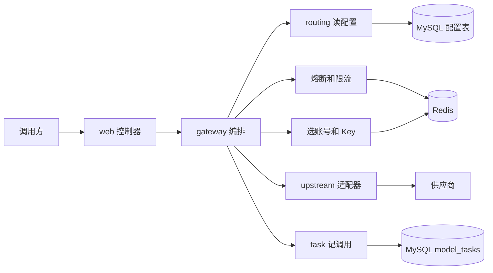

# llm-gateway

大模型网关。调用方只访问本服务，供应商地址和 API Key 放在 MySQL 里。进程启动只读取已有配置，不会写入供应商、账号或模型。

默认监听 `http://localhost:8080`。调用方不需要带上游 API Key，网关按模型选出账号后自己加上 `Authorization`。

## 一次调用怎么走

对话、视频创建、视频查询都走这条顺序。熔断按「模型 + 账号」，限流仍按模型。

```text
读 JSON，按 model_name 取模型
  -> 未启用：404
  -> 协议和这个接口不匹配：400
  -> 没有可调度账号：503
  -> 按负载均衡开关选账号，跳过这个模型上已经熔断的账号，再在选中的账号里轮换 Key
  -> 负载均衡关闭时只看 id 最小的账号；它已熔断则 503，不改投其他账号
  -> 候选账号全部熔断：503，不消耗 RPM
  -> 模型级 RPM：超限则 429，归还这个账号的半开名额，不记熔断
  -> 请求发到 models.base_url，带上选出的 API Key
  -> 按这次打到的账号回写熔断。同一次请求换了账号时，两个账号各记各的
  -> 写入 model_tasks，把响应交还调用方
```

可调度账号必须同时满足：挂在这个模型的 `model_accounts` 上且链接启用、账号启用、账号属于模型的供应商、至少一把启用的 Key。停用后下一次请求就排除，不用重启。

上游返回 `401`、`429` 或 `5xx`，并且还没向调用方写出字节时，换下一个尚未熔断的账号再试一次。这次不再给账号游标加一。400 一类参数错误不换账号。超时和连接失败不换账号，记这个账号一次熔断失败。流式对话第一块写出之后不再换账号，这次按成功记这个账号的熔断。

限流和熔断是两件事：

| | 限流 | 熔断 |
| --- | --- | --- |
| 看什么 | 最近 60 秒这个模型已经通过多少请求 | 这个模型上的这个账号是不是在连续调用失败 |
| 拒绝时 | 429，`rate_limit_error`，文案「模型请求超过限制」 | 503，`server_error`，文案「模型暂时不可用」 |
| 会不会换账号 | 不会。限流在账号已经选定之后，拒绝的是整个模型的额度 | 会。选账号和失败换账号时都跳过已经打开的账号 |
| 会不会把对方记成失败 | 限流拒绝不记入熔断失败 | 熔断拒绝发生在计数之前，不消耗 RPM |

一个模型触发限流，不影响其他模型。一个账号熔断，不影响同一模型的其他账号，也不影响其他模型。限流仍然按模型合计，不按账号。

## 负载均衡

开关在 `models.load_balance_enabled`，每个模型单独一份。已有模型默认开启，和升级前「每次请求都轮询」一致。

| 开关 | 选账号 |
| --- | --- |
| 开启 | 在可调度账号之间按 id 升序轮询。游标在 Redis，多实例共用 |
| 关闭 | 固定用当前池里 id 最小的账号，不推进账号游标 |

两种情况都会在选中的账号里继续轮换 Key。关闭负载均衡只是不再轮换账号。

开启时，这个模型当前可调度账号必须至少两个，否则管理接口返回 400，库里的开关不变。后来如果只剩一个账号，请求仍打到这一个，不会自动把开关改回关闭。一个都没有时返回 503「没有可用的供应商账号」。

## 模型级限流

开关和 RPM 在 `models` 上。开关关闭，或 RPM 不是正整数时，不计数。`models.tpm` 列还在，准入不读取。

计数在 Redis 里按模型做滚动 60 秒的滑动窗口。每次放行只记一条时间。判断前先丢掉年龄已经达到 60 秒的记录，条数会超过 RPM 时这次完全不记。分钟整点不会把计数清零。网关不按 Token 拒绝请求。供应商返回的 TPM 或 429，状态码和正文原样交还；还没写出字节、并且还有另一个未熔断账号时，会先换那个账号再试一次。

## 账号熔断

每个「模型 + 账号」一份状态，放在 Redis，多实例看到同一份。默认连续失败 5 次后打开，冷静 30 秒，半开同时只放 1 个试探。都可以用环境变量改，见下面的运行一节。阈值仍是进程级，不能按账号单独配置。

```text
CLOSED --连续失败达到阈值--> OPEN
OPEN   --冷静时间结束-----> HALF_OPEN
HALF_OPEN --试探成功------> CLOSED，失败计数清零
HALF_OPEN --试探失败------> OPEN，冷静时间重计
```

没有后台线程。OPEN 的冷静期到了之后，由下一次请求把状态改成 HALF_OPEN。

计入失败的是这个账号上的连接失败、超时、上游 5xx。不计入的是本网关限流、400 一类参数错误、401、上游 429，以及 Redis 轮询计数失败。2xx 和 3xx 把这个账号的连续失败清零。同一次请求先打到 A 再换到 B 时，A 按它自己的状态码记，B 再按 B 的结果记。半开时拿到名额的进程如果中途退出，120 秒租约过后允许新的试探。

负载均衡开启时，打开的账号在选路和换账号时被跳过。全部打开才返回 503。负载均衡关闭时，只检查 id 最小的账号，它打开就 503，即使后面还有健康账号。视频查询锁着创建任务的账号，该账号打开时也不改投。

## 架构

供应商协议、选账号、限流、熔断都在编排层串起来。控制器不选账号，适配器不决定要不要重试。



文本走 `openai`，视频走 `dashscope-wan`。视频查询多一步：`model_tasks` 里有任务号时，锁回创建它的账号，只在那个账号的 Key 之间轮换。

包按职责分开，新手按这个顺序打开：

| 顺序 | 包 | 先看哪个类 | 它负责什么 |
| --- | --- | --- | --- |
| 1 | `web` | `ChatCompletionController`、`VideoController` | 只接 HTTP，不选账号，不改正文 |
| 2 | `gateway` | `ModelAdmission`，然后是两个 Service | 选账号时按账号熔断，再模型级限流，然后调用、落库 |
| 3 | `routing` | `RouteResolver`、`RoundRobinAccountLoadBalancer` | 读配置表；按开关轮询或钉住最小账号 |
| 4 | `upstream` | `OpenAiChatAdapter`、`DashScopeWanAdapter` | 按供应商协议发请求。新供应商在这里加一个实现 |
| 5 | `admin` | `AdminController`、`AdminService` | 管理页用的读写接口。不走调用链 |
| 6 | `task` | `DbTaskBindingStore` | 把每次调用写入 `model_tasks` |
| 7 | `timeout`、`error`、`config` | `HeaderTimeoutPolicy`、`GatewayExceptionHandler` | 超时预算、错误 JSON、数据库和 Redis 连接 |

## 运行

需要 JDK 21。连接信息放在项目根目录的 `application-local.yml`（已加入 `.gitignore`），或放在环境变量里：

```yaml
MYSQL_SERVER: 主机:3306
MYSQL_USER: root
MYSQL_PASSWORD: 数据库密码
MYSQL_DATABASE: llm-gateway
REDIS_SERVER: 主机
REDIS_PASSWORD: Redis 密码
ADMIN_TOKEN: 管理页令牌
```

`REDIS_SERVER` 可以只写主机，端口默认 `6379`。环境变量若已设置，会盖过这个文件。

熔断参数有默认值，需要时再用环境变量覆盖：

| 变量 | 默认 | 含义 |
| --- | --- | --- |
| `GATEWAY_CIRCUIT_FAILURES` | `5` | 连续失败多少次进入 OPEN |
| `GATEWAY_CIRCUIT_OPEN_MS` | `30000` | 冷静时间，毫秒 |
| `GATEWAY_CIRCUIT_PROBES` | `1` | 半开状态同时允许的试探数 |
| `GATEWAY_CIRCUIT_PROBE_LEASE_MS` | `120000` | 试探名额租约，毫秒 |

```bash
export JAVA_HOME=/Library/Java/JavaVirtualMachines/temurin-21.jdk/Contents/Home
mvn spring-boot:run
```

不要执行 `sql/schema.sql`，那个脚本会先删除已有的表。已有库只缺任务表时，执行 `sql/model_tasks.sql`。已有库缺负载均衡和限流列时，执行一次 `sql/model_governance.sql`。已有库缺累计 Token 列时，执行一次 `sql/model_token_usage.sql`。已有库要给任务列表加速时，执行一次 `sql/model_task_list.sql`，它只给 `model_tasks` 加索引。

## 管理页

控制台源码在仓库根目录的 `console/`。技术栈是 Vue 3、Vue Router、Pinia、Vite、Element Plus、Axios、Sass、ECharts。开发时开两个进程：网关继续 `mvn spring-boot:run`，控制台在 `console/` 里执行 `npm install` 后执行 `npm run dev`，浏览器打开 `http://localhost:5173/admin/`。Vite 把 `/admin/api` 代理到 `http://localhost:8080`。

提交或只启动网关之前，在 `console/` 执行 `npm run build`。产物写入 `src/main/resources/static/admin`，访问地址是 `http://localhost:8080/admin/`。`/admin` 和 `/admin/` 都会进这个页面。

打开后先填 `ADMIN_TOKEN` 再进入。页面有六个视图：概览、供应商、账号与密钥、模型、调用任务、Token 消耗。模型的调用地址、调度账号、负载均衡和限流都在模型详情里改。它们都请求本服务的 `/admin/api/**`，浏览器里没有另一份假数据。界面是深色科技风。

Token 消耗按供应商、按模型筛选，表格和两张图都使用模型上的累计 Token，筛选结果上面有合计。图没有按次或按日的 Token 流水。已有库执行一次 `sql/model_token_usage.sql` 才会有 `models.consumed_tokens`。成功调用才累加：适配器读到 `usage.total_tokens` 时用真实值，流式或没有用量字段时用本次预估。这个预估不参与限流。失败、限流和熔断不累加。管理页保存模型时不会改这个数。

调用任务列表读取 `model_tasks`，一页一页向接口要，不把全表拉到浏览器。概览上的任务图使用最近 14 天的状态分布和每日数量，按创建日统计，后来的状态更新不会把任务挪到另一天。

每个管理请求带请求头 `X-Admin-Token`，值等于 `ADMIN_TOKEN`。没配置、没带头或令牌不对时返回 401，文案是「管理令牌不正确」。调用方的 `/v1/**` 不看这个头。

API Key 只在创建或更换时提交明文。任何查询只返回掩码，例如 `****` 加末四位。更新时如果密钥字段为空，或原样送回掩码，保持库里的原值。

调用地址写在模型上，供应商没有 Base URL。模型类型就是 `adapter_name`，下拉列表来自当前进程已经注册的适配器。参与调度的账号写在 `model_accounts`，并且必须属于这个模型的供应商。

| 用途 | 方法与路径 |
| --- | --- |
| 已注册适配器 | `GET /admin/api/adapters` |
| 供应商 | `GET/POST /admin/api/providers`，`PUT /admin/api/providers/{id}` |
| 账号 | `GET/POST /admin/api/accounts`，`PUT /admin/api/accounts/{id}` |
| 密钥 | `GET/POST /admin/api/accounts/{accountId}/keys`，`PUT /admin/api/keys/{id}` |
| 模型 | `GET/POST /admin/api/models`，`PUT /admin/api/models/{id}` |
| 调用配置 | `PUT /admin/api/models/{id}/invocation` |
| 负载均衡开关 | `PUT /admin/api/models/{id}/load-balance` |
| 限流 | `PUT /admin/api/models/{id}/rate-limit` |
| 调用任务 | `GET /admin/api/tasks` |
| 任务汇总 | `GET /admin/api/tasks/summary` |

## 接入新供应商

Google、字节如果提供 OpenAI 兼容的 Chat Completions，不用写新代码。在管理页新增模型，适配器选 `openai`，调用 URL 写成对方的完整地址。

对方是自己的协议时，实现 `ProtocolAdapter` 并标成 Spring Bean。`name()` 必须和 `models.adapter_name` 一致。启动后管理页的适配器列表会自动出现这个名字。适配器只改协议要求的头和模型名；选账号、限流、熔断仍由编排层处理。有 Token 用量时覆盖 `reportedTotalTokens`，成功调用才会把真实值累加到 `consumed_tokens`。它不改变 RPM。

## 数据

五张配置表：`providers`、`provider_accounts`、`account_keys`、`models`、`model_accounts`。调用地址写在 `models.base_url`，请求原样发到这个完整地址，不再拼接路径。另有一张 `model_tasks` 记录每次调用。

`models` 上和治理有关的列：

| 列 | 默认 | 含义 |
| --- | --- | --- |
| `load_balance_enabled` | `1` | `1` 在可调度账号间轮询，`0` 固定最小账号 |
| `rate_limit_enabled` | `0` | `1` 启用这个模型的 RPM |
| `rpm` | 空 | 每分钟最大请求数。空或 `0` 表示不限制。开启限流时必须是正整数 |
| `tpm` | 空 | 已停用。准入不读取，保存时写成空 |
| `consumed_tokens` | `0` | 这个模型累计消耗的 Token。只在成功调用后增加 |

`models.model_name` 是调用方使用的名字，`upstream_model_name` 是发给上游的名字。上游名为空时用调用名。账号轮询的游标不入库。

Redis 键：

| 键 | 内容 |
| --- | --- |
| `llm-gateway:rr:model:{modelId}:account` | 账号轮询游标 |
| `llm-gateway:rr:model:{modelId}:account:{accountId}` | 这个账号的 Key 游标 |
| `llm-gateway:rl:{modelId}` | 这个模型滚动 60 秒内的每次放行 |
| `llm-gateway:cb:{modelId}:{accountId}` | 这个模型上这个账号的熔断状态 |

每一次文本调用和视频创建写入 `model_tasks`：

| 字段 | 含义 |
| --- | --- |
| `task_id` | 视频用上游任务号；文本没有任务号时由网关生成 |
| `model_name` | 调用方模型名 |
| `provider_account_id` | 这次调用使用的供应商账号 |
| `task_status` | 视频用上游状态，例如 `PENDING`。文本成功为 `SUCCEEDED`，失败为 `FAILED` |
| `created_time` | 写入时间 |

同一个 `task_id` 再次写入时保留第一次的账号，只更新状态。查询视频任务时也只更新状态，不另开一行。

当前已启用、且调用名与上游名相同的模型：

| 模型名 | 适配器 | 调用地址 |
| --- | --- | --- |
| `qwen-max` | `openai` | `https://dashscope.aliyuncs.com/compatible-mode/v1/chat/completions` |
| `deepseek-flash` | `openai` | `https://api.deepseek.com/chat/completions` |
| `wan2.6-t2v` | `dashscope-wan` | `https://dashscope.aliyuncs.com/api/v1/services/aigc/video-generation/video-synthesis` |
| `wan3.0-video` | `dashscope-wan` | 与 `wan2.6-t2v` 相同 |

库里还留着旧行 `wan2.0`、`wan3.0`，上游名分别是 `wan2.6-t2v`、`wan3.0-video`。新调用直接用上表里的真实模型名。

## 公共约定

两个 `POST` 的请求头：

```http
Content-Type: application/json
```

可选请求头，三个接口都认：

| 请求头 | 含义 |
| --- | --- |
| `X-Gateway-Timeout-Ms` | 这一次上游调用的超时，单位毫秒，必须是正整数。不传时为 `120000`。`0`、负数或非整数返回 400。 |
| `X-Gateway-Client-Id` | 预留给以后按调用方限流。当前模型级限流不使用它。 |

网关自己的错误是 JSON：

```json
{
  "error": {
    "message": "模型不存在或已停用",
    "type": "invalid_request_error"
  }
}
```

`type` 有四种：`invalid_request_error`、`not_found`、`server_error`、`rate_limit_error`。上游返回的 4xx/5xx 不套这个结构，状态码和正文原样交还。模型限流是网关自己的 429，`type` 为 `rate_limit_error`。账号熔断是 503，文案为「模型暂时不可用」。

| 状态码 | 何时出现 |
| --- | --- |
| 400 | 请求体不是 JSON 对象、缺少 `model` 或 `message`、模型协议不匹配、任务 ID 不合法、超时头非法。管理接口的字段不合法也是 400 |
| 401 | 管理接口缺少或带错 `X-Admin-Token`。`/v1` 不会返回这个 |
| 404 | 模型名不存在或已停用 |
| 429 | 这个模型的 RPM 已满时，是网关自己的 JSON。供应商的 429，包括 TPM 错误，是上游正文 |
| 502 | 连不上上游。记这个账号一次熔断失败 |
| 503 | 没有可用账号、当前候选账号都处于熔断、Redis 计数不可用，或任务表读写失败 |
| 504 | 上游在超时预算内没有完成。记这个账号一次熔断失败 |

对话和视频创建遇到上游 `401`、`429` 或 `5xx`，且还没向调用方写出正文时，会换下一个账号再试一次。其他 4xx 直接返回。超时不重试。

## POST /v1/chat/completions

文本对话。只接受适配器为 `openai` 的模型，例如 `qwen-max`、`deepseek-flash`。视频模型打到这里会返回 400，`error.message` 为「该模型不能用于对话接口」。

业务方传 `message` 字符串即可。网关发给上游时把它写成一条 `user` 消息，并去掉原来的 `message` 字段。发给上游的 `model` 是表里的 `upstream_model_name`，这一列为空时用调用名。`max_tokens`、`temperature` 等其余字段原样转发。

未传 `thinking` 时，网关补上 `{"type":"disabled"}`，默认关闭思考。需要思考时自己传 `{"type":"enabled"}`，网关不会覆盖。

| 字段 | 类型 | 必填 | 说明 |
| --- | --- | --- | --- |
| `model` | string | 是 | 调用方模型名，对应 `models.model_name`，不能为空 |
| `message` | string | 是 | 用户要说的话，不能为空。不要传消息对象或数组 |
| `stream` | boolean | 否 | 默认 `false`。`true` 时按 SSE 边收边转发 |
| `thinking` | object | 否 | 不传则关闭思考。打开时传 `{"type":"enabled"}` |
| 其他字段 | 任意 JSON | 否 | 例如 `max_tokens`、`temperature`，原样转发 |

`message` 缺失、为空，或不是字符串时返回 400，`error.message` 为「message 必须是非空字符串」。

```bash
curl http://localhost:8080/v1/chat/completions \
  -H 'Content-Type: application/json' \
  -d '{
    "model": "deepseek-flash",
    "message": "只回复一个字：好",
    "max_tokens": 16
  }'
```

`qwen-max` 使用同一路径，只把 `model` 换成 `qwen-max`。

成功时状态码和正文都是上游的，常见形状：

```json
{
  "choices": [
    {
      "message": {
        "role": "assistant",
        "content": "好"
      }
    }
  ]
}
```

流式把 `stream` 设为 `true`。响应 `Content-Type` 为 `text/event-stream`，内容是上游的 SSE 分块。第一块写出之后不再换账号。

## POST /v1/video/synthesis

万相异步视频创建。只接受适配器为 `dashscope-wan` 的模型。文本模型打到这里返回 400，`error.message` 为「该模型不能用于视频接口」。

网关只要求正文是 JSON 对象，并且 `model` 是非空字符串。`input`、`parameters` 以及其他字段按百炼视频接口原样转发。创建后立刻返回任务，不会等到视频生成完成。

| 字段 | 类型 | 必填 | 说明 |
| --- | --- | --- | --- |
| `model` | string | 是 | `wan2.6-t2v` 或 `wan3.0-video` |
| `input` | object | 由上游决定 | 已联通的写法是 `{"prompt":"..."}` |
| `input.prompt` | string | 由上游决定 | 视频描述 |
| `parameters` | object | 由上游决定 | 分辨率、时长等，两个模型的字段不同 |

`wan2.6-t2v`：

```bash
curl http://localhost:8080/v1/video/synthesis \
  -H 'Content-Type: application/json' \
  -d '{
    "model": "wan2.6-t2v",
    "input": {"prompt": "一只小猫在草地上走路"},
    "parameters": {
      "size": "1280*720",
      "duration": 2,
      "prompt_extend": false
    }
  }'
```

`wan3.0-video` 的分辨率和画幅用另一组字段：

```bash
curl http://localhost:8080/v1/video/synthesis \
  -H 'Content-Type: application/json' \
  -d '{
    "model": "wan3.0-video",
    "input": {"prompt": "一只小猫在草地上走路"},
    "parameters": {
      "resolution": "480P",
      "ratio": "16:9",
      "duration": 2,
      "prompt_extend": false
    }
  }'
```

成功时正文是上游的创建结果，里面有任务 ID，没有成片地址：

```json
{
  "output": {
    "task_id": "任务 ID",
    "task_status": "PENDING"
  }
}
```

`task_status` 还可能是 `RUNNING`、`SUCCEEDED`、`FAILED`、`CANCELED`、`UNKNOWN`。拿到 `task_id` 后用查询接口看进度。网关会把这一行写入 `model_tasks`。

## GET /v1/tasks/{taskId}?model=

查询上面创建的任务。`model` 是查询参数，必填，取值和创建时相同。

```bash
curl 'http://localhost:8080/v1/tasks/这里换成task_id?model=wan2.6-t2v'
```

| 位置 | 名字 | 类型 | 必填 | 说明 |
| --- | --- | --- | --- | --- |
| 路径 | `taskId` | string | 是 | 创建响应里的 `output.task_id`。不能为空，也不能包含 `/` 或 `\` |
| 查询参数 | `model` | string | 是 | 创建时的视频模型名。缺少时返回 400，「缺少模型名」 |

没有请求体。文本模型作为 `model` 时返回 400，`error.message` 为「该模型不能用于视频查询」。

`model_tasks` 里有这个 `task_id` 时，查询固定走创建它的账号，并把 `task_status` 更新成这次查到的状态。没有记录时按这个模型当前的负载均衡开关选账号。成功时正文仍是上游 JSON。状态变为 `SUCCEEDED` 后，成片地址在上游正文里，网关不另做封装。
