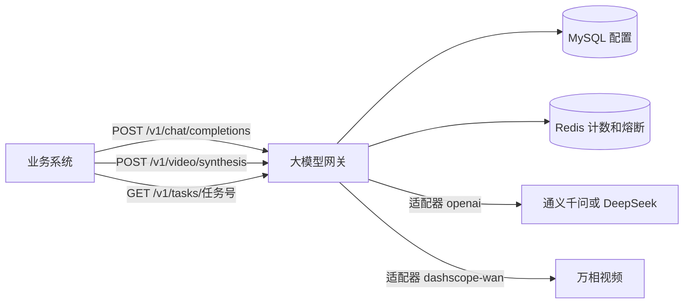
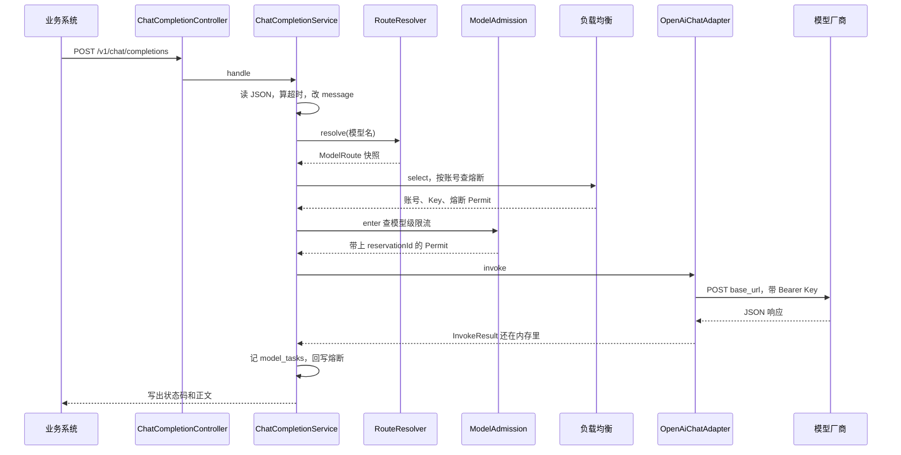

# 第 1 课：大模型网关到底是什么

### 1. 本节课我们要学什么？

先不要打开 Java 文件。这一课只建立三句话：网关站在业务系统和模型厂商中间；调用方只说「我要用哪个模型、说什么话」；地址、钥匙、能不能打、打哪一个账号，都由网关决定。

学完你应该能向一个没看过代码的同事讲清楚：为什么不让业务系统直接请求 OpenAI 或通义千问。

### 2. 先讲一个生活中的例子

公司要订机票。如果每个员工自己去各家航司网站下单，会发生四件麻烦事。

第一，每家网站的按钮不一样。东航要身份证，南航要手机号，国际航司要护照。业务同学得为每一家写一套表单。

第二，公司有三张信用卡。员工不知道今天该刷哪一张，经常把同一张刷爆，另外两张闲着。

第三，某家航司网站挂了。员工还在不停刷新，公司网络和那张信用卡一起遭殃，而且没人统计「这家已经连续失败五次了，先别打」。

第四，财务要对账。员工的确认邮件散落在各人邮箱里，月底对不上哪张卡买了哪张票。

大模型网关就是这家公司的订票处。业务系统是来订票的员工。OpenAI、通义千问、DeepSeek、万相是不同的航司。网关统一收单，自己选卡，自己翻译成航司要的表格，自己记下这一单。

### 3. 为什么需要这个技术？

直接让业务系统调用模型厂商，短时间内能跑通一个演示。模型一多，问题就具体了。

- 每接一家，业务代码就要认识那一家的 URL、请求头和响应字段。通义千问兼容对话接口和万相视频接口甚至不是同一套协议。
- API Key 会散落在各个业务服务的环境变量里。轮换一把 Key，要发一次版。Key 泄露时你不知道是哪个服务带出去的。
- 一家模型变慢或开始返回 500，所有业务还在同时打它。没有人站在中间说「这个模型先歇 30 秒」。
- 账单对不上。业务只知道自己发过请求，不知道最后打到了哪个账号。

网关把这些事收口。业务系统只访问本服务，默认 `http://localhost:8080`。它不带上游 API Key。网关按模型选出账号后，自己加上 `Authorization`。

### 4. 技术原理

大模型网关是一层反向代理加上自己的业务规则。说人话：外面的人把请求交给你，你检查完、改完、选好出口，再替他去问真正的模型，然后把他需要的结果交还。

它不是模型本身。它不生成「你好」。生成文字的是上游模型。网关负责的是准入、翻译、转发、记账。

OpenAI 兼容协议解决的是「表格长得一样」。Chat Completions 这套 JSON 大致是：

- 请求里有 `model`、`messages`，还可以有 `temperature`、`max_tokens`、`stream`。
- 响应里有 `choices`，助手的话在 `choices[0].message.content`。
- 流式时用 SSE，一块一块把增量推回来。

谁家实现了这套形状，网关就可以用同一份适配器去打它。本项目里这份适配器叫 `openai`，类名是 `OpenAiChatAdapter`。通义千问的 `qwen-max` 和 DeepSeek 的 `deepseek-flash` 都走它。地址不同，写在各自的 `models.base_url` 里，代码不按厂商名再写 if。

协议一样，不代表所有模型都能塞进这一个接口。万相视频是异步的：你先拿到一个 `task_id`，视频过一会儿才做好，查询要用另一个 URL，还要带 `X-DashScope-Async: enable`。这件事 `openai` 适配器不会做，所以另有 `DashScopeWanAdapter`。

网关在整个系统里的位置可以想成：

```text
业务系统（你的 Vue / Node 服务）
        |
        |  只认识网关的三个地址，不认识厂商 Key
        v
   llm-gateway
        |
        |  自己加 Key，自己选账号
        v
 通义千问 / DeepSeek / 万相
```

一个真实业务请求要经过网关，是因为「用哪个模型」是业务决策，但「这个模型今天打哪把钥匙、现在允不允许打、失败了换不换账号」是平台决策。混在业务服务里，每来一个新产品都要复制一套。

### 5. 放到我们的项目中

当前对外只有三类调用，都在 README 和控制器上对得上。

| 业务想做的事 | 调用的地址 | 网关用的适配器 |
| --- | --- | --- |
| 文本对话 | `POST /v1/chat/completions` | `openai` |
| 创建视频任务 | `POST /v1/video/synthesis` | `dashscope-wan` |
| 查询视频任务 | `GET /v1/tasks/{taskId}?model=` | `dashscope-wan` |

调用方传的 `model` 是表 `models.model_name`，例如 `deepseek-flash`。发给上游的名字是 `upstream_model_name`，这一列为空时才退回调用名。地址是这一行的 `base_url`，请求原样发到这个完整地址，网关不再在后面拼接 `/chat/completions`。所以地址必须写成厂商文档里的完整路径。

仓库 README 里当前启用、且调用名与上游名相同的模型是：`qwen-max`、`deepseek-flash`、`wan2.6-t2v`、`wan3.0-video`。库里如果还留着旧名字，以你库里的实际数据为准。网关启动时不会往这些表里插入模型。

Google 或字节如果提供的就是 Chat Completions，不需要新写 Java。在管理页加一行模型，适配器选 `openai`，调用 URL 写成对方的完整地址。对方如果是自己的一套 JSON，才需要新的适配器类。这件事第 5 课和第 8 课会按代码走一遍。

### 6. 核心代码逐段讲解

这一课只看「门」。门非常薄，薄本身就是设计。

文件：`src/main/java/com/llmgateway/web/ChatCompletionController.java`

```java
@RestController
public class ChatCompletionController {

    private final ChatCompletionService service;

    public ChatCompletionController(ChatCompletionService service) {
        this.service = service;
    }

    @PostMapping("/v1/chat/completions")
    public void chat(HttpServletRequest request, HttpServletResponse response) throws IOException {
        service.handle(request, response);
    }
}
```

`@RestController` 告诉 Spring：这个类负责接 HTTP。你可以把它当成 Vue Router 里的一个路由组件，但它运行在服务器上。

`@PostMapping("/v1/chat/completions")` 就是路径。只有 POST 到这个路径会进 `chat`。

构造方法里的 `ChatCompletionService` 不是控制器自己 `new` 的。Spring 启动时发现控制器需要它，就把已经创建好的服务对象传进来。这叫构造方法注入。类比：你写一个 composable，不在里面 `axios.create()`，而是让外面把已经配好 baseURL 的实例传进来。好处是测试时可以换一个假的服务，业务代码不用改。

返回类型是 `void`，而且方法直接拿到了 `HttpServletResponse`。这是有意的。如果写成 `return 一个对象`，Spring 会等你的方法结束，再把对象序列化成 JSON 一次吐出。流式对话要「模型生成一个字就往外推一个字」，不能等全部生成完。所以控制器把原始的请求和响应交给服务，由服务决定是最后写一整段 JSON，还是边收边写。

控制器不读 `model`，不选账号，不改 JSON。这些是后面的课的内容。视频的门在 `VideoController`，同样只转给 `VideoSynthesisService`。

### 7. 配图理解

业务系统和网关、厂商的关系：



顺着图看一遍。

1. 业务系统只画了三条线，都打到网关。它没有直连厂商。
2. 网关先问 MySQL：这个模型名对应哪一行、地址是什么、哪些账号能用。
3. 网关再问 Redis：轮询轮到哪个账号、这个账号在这个模型上熔断了没有、这个模型最近 60 秒的次数和 Token 满了没有。
4. 文本走左边的厂商，视频走右边的厂商。走哪边不看厂商公司名字，看这一行模型的 `adapter_name`。

### 8. 常见误区

- 「网关就是把 URL 换个壳。」不对。换地址只是最后一步。前面还有模型是否启用、协议是否匹配、有没有账号、熔断、限流、选 Key。
- 「OpenAI 兼容意味着所有模型都能打 `/v1/chat/completions`。」不对。视频模型打这个地址会得到 400，「该模型不能用于对话接口」。兼容指的是文本这一家协议，不是所有能力。
- 「调用方把厂商的 API Key 放在 Authorization 里带给网关。」不对。网关不转发调用方自己的 Authorization。Key 来自表 `account_keys`，由网关选中后放进发给上游的请求头。
- 「项目里已经有图像生成。」没有。不要在代码里找画图接口。

### 9. 本节课总结

网关是业务系统和模型厂商之间的订票处。它用统一入口挡住各家协议、钥匙和故障。本项目文本走 `openai` 适配器，视频走 `dashscope-wan` 适配器。控制器只是门，真正的规则在后面的服务里。

### 10. 课后练习

入门：用自己的话说明，业务系统为什么可以不保存通义千问的 API Key。

参考答案：Key 存在网关的 MySQL 表 `account_keys` 里。业务系统只请求网关。网关选出账号和 Key 后，在 `OpenAiChatAdapter` 或 `DashScopeWanAdapter` 里加上 `Authorization: Bearer ...`。调用方的请求头不会被原样转发给厂商。

进阶：`qwen-max` 和 `deepseek-flash` 是两家公司的模型，为什么可以共用一个 Java 类？

参考答案：两家的对话接口都按 OpenAI Chat Completions 的形状收 JSON、收回 JSON。差别是 `models` 表里的 `base_url` 和 `upstream_model_name`。`OpenAiChatAdapter` 把请求发到这一行的 `base_url`，不在代码里写「如果是千问就怎样」。

实战：对着 README 的「公共约定」，列出网关自己的错误 JSON 长什么样，以及哪四种 `type`。确认你能和直接透传的上游错误区分开。

参考答案：网关自己的错误是 `{"error":{"message":"...","type":"..."}}`。`type` 为 `invalid_request_error`、`not_found`、`server_error`、`rate_limit_error`。上游返回的 4xx/5xx，在还没被网关自己的规则拦住时，状态码和正文原样交还，不套这层结构。

---

# 第 2 课：从用户发起请求到模型返回结果

### 1. 本节课我们要学什么？

把一次文本对话在业务上走完。这一课仍然不逐行抠算法，但你要能按顺序说出：请求怎么进来、模型怎么被认出来、配置从哪来、请求怎么被改写、谁去访问厂商、响应怎么回去。

视频的创建和查询留到第 4 课对比。这里用一条最常见的路把骨架立住。

### 2. 先讲一个生活中的例子

你在公司内部系统里点「让 AI 回复客户」。系统不会把你的屏幕直接接到模型机房。它像寄快递：

1. 你填写运单：发给谁（模型名）、包裹里是什么（那句话）。
2. 收件员检查运单是否填写完整。
3. 调度室查这班线路今天开不开、有没有被临时停运、这一分钟是不是已经发太多次。
4. 仓库选出一把可以开门的钥匙，把包裹改成对方仓库认识的标签。
5. 司机送到对方仓库。对方可能整车卸货（普通 JSON），也可能一边分拣一边从传送带送出来（流式）。
6. 调度室在台账上记：这单用了哪把钥匙、成功还是失败。

你作为寄件人，最后拿到的是对方的回执，或者是调度室自己开的拒收单。这两种单据长相不同。第 1 课已经说过这个区别。

### 3. 为什么需要这个技术？

如果没有一条固定顺序，每个开发者会按自己的习惯插入检查。有人会在账号已经熔断时仍去轮换它的 Key，下一个正常用户就被跳过。有人先把请求发给上游，发现模型停用了，上游已经计费。

本项目把顺序写死在 `ChatCompletionService` 的类注释里。注释甚至写了「顺序不能调换」。你以后改代码，先问：我插进去的逻辑，是在选账号之前还是之后？在字节写给调用方之前还是之后？这两个时间点决定了能不能重试、会不会重复扣费、会不会把错误记成模型故障。

### 4. 技术原理

一次调用在逻辑上分三段。

准备段。把 HTTP 正文读成 JSON，确认模型存在，把业务方习惯的字段收成厂商习惯的字段，算出这次最多等多久。

执行段。选账号时先看这个账号的熔断，打开的跳过，再轮换 Key。账号定了之后问模型级限流能不能走，然后发 HTTP。如果厂商明确用 HTTP 状态说「这把钥匙不行或我这边 500」，并且网关还没把任何字节写给业务系统，就换下一个还没熔断的账号再试一次。换之前先把前一个账号自己的结果记进它的熔断。

收尾段。按最后打到的那个账号更新它的熔断，把成功时的 Token 记到模型上，把缓冲好的 JSON 写回业务系统。流式的情况特殊：字节已经在执行段写出去了，收尾段不能再写第二遍。

对应到代码，准备段和收尾段的大部分在 `ChatCompletionService.handle`，执行段进入 `OpenAiChatAdapter.invoke`，记账在 `CallRecords`，准入口径在 `ModelAdmission`。

### 5. 放到我们的项目中

用一个具体请求把变量走一遍。业务系统发送：

```http
POST /v1/chat/completions
Content-Type: application/json
X-Gateway-Timeout-Ms: 30000

{
  "model": "deepseek-flash",
  "message": "只回复一个字：好",
  "max_tokens": 16
}
```

下面是 `handle` 里真实发生的事，类名都是代码里的。

1. `JsonBodies.object` 把正文读成一个 JSON 对象。空正文、数组、坏 JSON 都是 400，「请求体不是合法 JSON」或「请求体必须是 JSON 对象」。
2. `JsonBodies.requiredText(body, "model")` 取出 `deepseek-flash`。缺了就是 400，「缺少模型名」。
3. `HeaderTimeoutPolicy.resolve` 读到 `30000`，得到 30 秒的等待预算。这次如果换账号重试，仍用这 30 秒，不会重新读请求头。没传这个头时用配置，默认 120000 毫秒。
4. `RouteResolver.resolve("deepseek-flash")` 查 `models`。行不存在或 `enabled` 不是 1，返回 404，「模型不存在或已停用」。`adapter_name` 在进程里没有对应适配器，返回 400，「不支持的协议适配器」。一个可用 Key 都没有，返回 503，「没有可用的供应商账号」。通过后得到一份 `ModelRoute` 快照：模型 id、地址、上游模型名、账号列表、负载均衡开关、限流开关和 RPM。快照上还留着 TPM 字段，准入不读取。这份快照在这一次请求里不再变。
5. `AdapterRegistry.required` 拿到 `OpenAiChatAdapter`。它不支持 `CHAT_COMPLETION` 的话会被拒绝。`openai` 支持，所以继续。
6. `rewritePlainMessage` 检查 `message` 必须是非空字符串，然后写成 `messages: [{role: user, content: 只回复一个字：好}]`，并删掉原来的 `message`。如果你还自己带了 `messages`，也会被这一条盖掉。
7. `disableThinkingByDefault` 发现你没传 `thinking`，补上 `{"type":"disabled"}`。你如果传了 `{"type":"enabled"}`，原样保留。
8. `stream` 看 JSON 布尔值。你没传，按 `false`。字符串 `"true"` 不会被当成流式。
9. `RateWindows.estimate` 用改写之后的 JSON 字节数除以 4，至少为 1。这是调用前的 Token 占位，不是厂商后来账单上的精确值。
10. `RoundRobinAccountLoadBalancer.select` 按负载均衡开关选起点。每个候选账号先 `acquire(模型id, 账号id)`。这个账号的熔断开着就跳过，不轮换它的 Key。负载均衡关闭时只检查 id 最小的账号，它开着就 503，不往后找。候选全部开着也是 503，「模型暂时不可用」，这次不消耗 RPM。
11. `ModelAdmission.enter` 对已经选定的账号查模型级限流。超限则 429，「模型请求超过限制」，归还这个账号的半开名额，不记熔断失败，也不打上游。账号游标在第 10 步已经加过。
12. `OpenAiChatAdapter.invoke` 把 JSON 里的 `model` 换成上游模型名，加上 `Authorization: Bearer 选中的 Key`，POST 到 `base_url`。
13. 若状态是 401、429 或 5xx，并且一个字节都还没写给业务系统，先 `admission.observe` 把这次结果记到当前账号，再 `nextAccount` 换下一个还没熔断的账号试一次。后面的账号都开着，或快照里只有一个账号，就把第一次的结果返回。400 不换。超时和连接失败直接抛出去，不换账号，并 `admission.fail` 记在已经选中的那个账号上。
14. `CallRecords.record` 在每次真正拿到 HTTP 响应后写 `model_tasks`。文本没有上游任务号，主键是网关生成的 UUID。
15. `ModelAdmission.finish` 只看最后这一次、最后这个账号。2xx 和 3xx 把这个账号的连续失败清零；5xx 给这个账号记一次失败；401、429、400 一类既不算失败也不算恢复。前一个账号的记录已经在第 13 步的 `observe` 里写过，不会被这次成功清掉。非流式如果正文里有 `usage.total_tokens`，用它修正这次放行计入的 Token，并累加 `models.consumed_tokens`。
16. 非流式结果还在内存里，`ResponseWriter.writeBuffered` 这时才写给业务系统。所以第 13 步才有机会丢掉第一次的失败正文，而不是把两段 JSON 拼给调用方。

流式时第 12 步在状态码是 2xx 之后就开始往 `response` 写 SSE，返回值里 `committed` 为 true。第 16 步看到已经写过，就不再写。第一块写出之后也不会再换账号。

### 6. 核心代码逐段讲解

顺序就在这个方法里。文件：`src/main/java/com/llmgateway/gateway/ChatCompletionService.java`，方法 `handle`。

```java
ObjectNode body = JsonBodies.object(mapper, request.getInputStream());
String model = JsonBodies.requiredText(body, "model");
Duration timeout = timeoutPolicy.resolve(request);
ModelRoute route = routes.resolve(model);
ProtocolAdapter adapter = adapters.required(route.adapterName());
if (!adapter.supports(AdapterOperation.CHAT_COMPLETION)) {
    throw new GatewayException(400, ErrorTypes.INVALID_REQUEST, "该模型不能用于对话接口");
}
rewritePlainMessage(body);
disableThinkingByDefault(body);
boolean stream = body.path("stream").asBoolean(false);
int estimate = RateWindows.estimate(mapper.writeValueAsBytes(body));
Selection selected = loadBalancer.select(route);
Permit permit = admission.enter(route, selected.account().accountId(), selected.circuitPermit(),
        CallerContext.from(request), estimate);
```

读的时候注意三件容易滑过去的事。

第一，协议检查在改正文之前。视频模型打到对话接口，你应该看到「该模型不能用于对话接口」，而不是「message 必须是非空字符串」。所以 `supports` 在 `rewritePlainMessage` 前面。

第二，Token 估算用的是改正文之后的字节。`message` 已经变成 `messages`，思考字段也补上了。后面适配器还会把 `model` 换成上游名，那一点字节差不再重算。这个估算只在成功后、又没有真实用量时，累加到 `consumed_tokens`。它不参与限流，也不是账单。

第三，`loadBalancer.select` 在 `admission.enter` 前面。熔断发生在选账号里面：打开的账号被跳过，Key 游标不加。限流发生在账号已经选定之后。所以 429 时，这一轮的账号游标和 Key 游标已经加过，只是没有打上游。全部账号都熔断时，负载均衡开着的话账号游标也已经加过，Key 游标不加，RPM 不加。

异常不是在 `handle` 里拼 JSON 的。`GatewayException` 抛出后，由 `GatewayExceptionHandler.handleGateway` 写成 `error.message` 和 `error.type`。这是 Spring 的 `@RestControllerAdvice`：你可以把它当成一个全局的 `catch`，专门接控制器和服务抛出的某类异常。类似前端 axios 响应拦截器，在一个地方统一处理 401。差别是它运行在服务器上，改的是即将返回的 HTTP 响应。

### 7. 配图理解

一次非流式文本请求的时序：



逐步看。

1. 门不做事，只把请求交给编排。
2. 路由返回的是快照。同一次请求后面的重试用这份账号列表，不会中途再查库。
3. 熔断把所有候选账号都拒绝时，图在 `select` 就断了，不会问限流，也不会访问厂商。限流 429 发生在账号已经选出之后，同样不会访问厂商。
4. 适配器访问厂商时，业务系统还在等。非流式要等厂商把整段 JSON 给完，网关才写回。
5. 若厂商返回 401、429 或 5xx，编排会在「写出」之前再找下一个账号。图里没画第二次，是为了先看清主路径。第 4 课会补上这次换账号，第 5 课会解释为什么这次不推进账号游标。

### 8. 常见误区

- 「选账号发生在查数据库之前。」相反。没有快照就不知道有哪些账号。熔断就在选这些账号的时候看，打开的账号不会去动它的 Key。限流在账号选定之后。
- 「网关把厂商响应再包一层自己的 JSON。」成功时不包。状态码和正文都是上游的。只有网关自己拒绝时才用 `error` 结构。
- 「换账号会再把 `message` 解释一次。」不会。注释写明正文只改一次，第二次用同一份 `messages`。
- 「超时了会自动换下一个账号。」不会。超时抛 `GatewayException` 504，走失败分支，给当前账号记一次熔断失败，不调用 `nextAccount`。

### 9. 本节课总结

一次文本调用是一条不能随便调换的流水线：读 JSON、认模型、对协议、改正文、按账号熔断来选账号、再做模型级限流、发 HTTP、记账、按每个打到的账号回写熔断、再把还没写出的正文交还调用方。你现在应该能不看代码，按这个顺序讲完，并指出 404、400、429、503 分别可能出现在哪一步。

### 10. 课后练习

入门：调用方没传 `thinking` 时，发给上游的 JSON 里会多出什么？如果传了 `{"type":"enabled"}` 呢？

参考答案：没传或是 null，网关补 `thinking.type=disabled`，避免短句也先想很久。传了任何非 null 的 `thinking`，包括打开思考，原样保留。空对象也算传了，不再补默认值。代码在 `ChatCompletionService.disableThinkingByDefault`。

进阶：为什么非流式响应要先放在内存里，而不是一收到上游字节就写给业务系统？

参考答案：因为 401、429、5xx 还可能换账号。如果第一段错误 JSON 已经写出去，就不能撤回，也不能再写第二家的成功 JSON。`InvokeResult.committed` 为 false 表示还没写。流式一旦开始写，`committed` 为 true，编排层禁止再试。

实战：假设 `deepseek-flash` 被管理页停用。请求打到 `/v1/chat/completions` 时，会在 `handle` 的哪一次调用里结束？状态码和文案是什么？会不会访问 DeepSeek 的服务器？

参考答案：在 `routes.resolve(model)` 里结束。`RouteResolver` 看到 `enabled != 1`，抛 404，「模型不存在或已停用」。不会选账号，不会发上游 HTTP。停用对下一次新请求生效，不需要重启进程，因为每次请求都重新查库。
