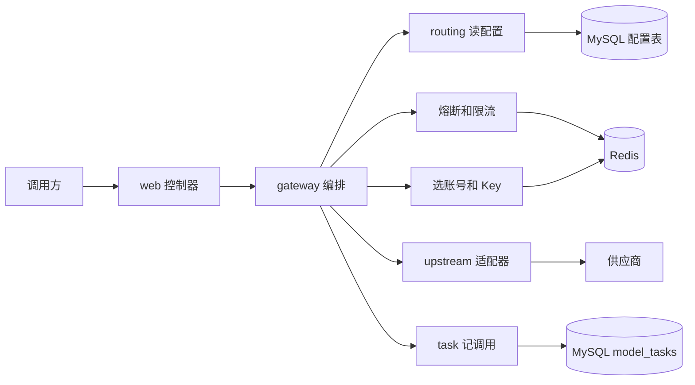
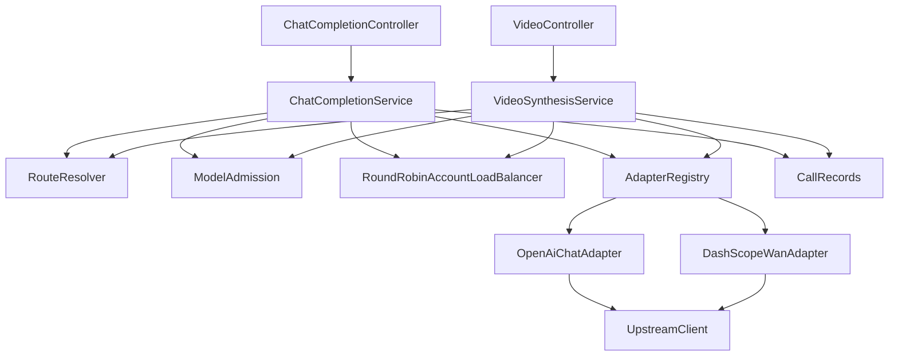

# 第 3 课：项目整体架构

### 1. 本节课我们要学什么？

知道代码为什么分成 `web`、`gateway`、`routing`、`upstream`、`task`、`admin` 这些包，每个包接收什么、交出什么，以及哪些数据在 MySQL、哪些在 Redis、哪些只活在一次请求的内存里。

学完你应该能在 IDE 的包列表上指出：改协议去哪，改轮询去哪，改错误 JSON 去哪。

### 2. 先讲一个生活中的例子

一家小餐馆如果老板一个人又招呼客人、又炒菜、又管进货、又记账，客人少的时候没问题。等菜单分成「热菜」和「需要等两小时的烧烤预订」，老板就会把活拆开。

前厅只负责把菜单送进后厨，不决定用哪口锅。

档口经理看这道菜今天还接不接、排队满了没有，再决定交给哪位厨师。

厨师只按菜谱把这口锅里的菜做出来，不决定要不要给隔壁桌换一位厨师。

账房只记账。库房记下「供应商、账号、钥匙、菜品地址」。黑板上写下「这一分钟卖了几份、这道菜是不是连续做糊了、下次轮到哪位厨师」。黑板和账本不是同一本，因为黑板要所有分店同时看见，而且可以过期；账本要留下来对账。

本项目的包就是这些岗位。硬塞进一个类，文本和视频的重试规则会缠在万相的请求头里面。你改熔断阈值时，会不敢动，因为旁边就是拼 URL 的代码。

### 3. 为什么需要这个技术？

没有分层时，最常见的事故是职责串门。

- 控制器里写 SQL，测试一个 404 必须连上真实数据库。
- 适配器里写「如果 500 就换账号」。换账号需要知道还有哪些账号，适配器就开始依赖选路。加一家新厂商时，重试逻辑被复制一份，两份很快就不一样。
- 限流写在某一个适配器里。视频接口忘了抄，视频模型没有保护。

现在的边界是 README 里那句：供应商协议、选账号、限流、熔断都在编排层串起来。控制器不选账号，适配器不决定要不要重试。

### 4. 技术原理

先补三个你会反复遇到的 Spring 词。

Bean。一个被 Spring 创建、保管、按类型交给别人的对象。`@RestController`、`@Service`、`@Component`、`@Configuration` 里的 `@Bean` 方法，都会产生 Bean。你很少在业务代码里 `new OpenAiChatAdapter()`。你写构造方法参数，Spring 负责传入。这套机制叫 IoC，控制反转：对象的创建权不在你手里，在容器里。类比一个依赖注入系统，类似前端把已经创建好的 axios、router 提供给组件，而不是每个组件自己连数据库。

包。Java 用包名分文件夹。`com.llmgateway.gateway` 就是目录 `src/main/java/com/llmgateway/gateway/`。它不是运行时的网络隔离，只是人的边界。真正的隔离靠「这个类的方法到底做什么」。

一次请求里的数据有三种寿命。

- 请求内存：`ObjectNode` 正文、`ModelRoute` 快照、`Selection`、`InvokeResult`。请求结束就没了。
- MySQL：供应商、账号、Key、模型、模型与账号的关系、每一次调用的任务行、模型累计 Token。进程重启还在。每次新请求重新读模型配置，所以停用不用重启。
- Redis：账号轮询游标、Key 游标、每个模型最近 60 秒的限流记录、每个「模型 + 账号」的熔断状态。多实例必须看同一块黑板，否则两台机器各自从 0 轮询，会把同一个账号同时打满。

配置不缓存进 Redis。`DbModelCatalog` 的注释写明：每次请求都读库。同一次请求的重试用的是已经组好的快照，不会读到一半换池。

### 5. 放到我们的项目中

进程从 `LlmGatewayApplication.main` 进来，Spring 扫到各个 Bean，应用开始听 8080。和架构有关的启动细节有两个。

`@MapperScan` 只登记标了 MyBatis `@Mapper` 的接口。`RateLimiter` 这种业务接口没有这个注解，不会被当成 SQL。

`@EnableConfigurationProperties(GatewayProperties.class)` 把 `application.yml` 里 `gateway:` 下面的超时和熔断参数绑到 `GatewayProperties`。供应商地址不在这个 YAML 里。

各包的输入和输出：

| 包 | 输入 | 做什么 | 输出 |
| --- | --- | --- | --- |
| `web` | HTTP 请求 | 按路径交给对应服务 | 不产生业务对象 |
| `gateway` | 请求、响应 | 排顺序：校验、选路、准入、调用、重试、落库 | 调用适配器，最后写响应 |
| `routing` | 模型名 | 读 MySQL 组成 `ModelRoute`；用 Redis 做轮询、限流、熔断 | `ModelRoute`、`Selection`、`Permit` 或异常 |
| `upstream` | `InvokeCommand` | 按协议改头和模型名，用 `UpstreamClient` 发 HTTP | `InvokeResult` |
| `task` | 任务号、模型名、账号、状态 | 插入或更新 `model_tasks` | 无。失败变成 503 |
| `admin` | `/admin/api` 加管理令牌 | 改配置、查任务列表 | JSON 给 Vue 控制台 |
| `error` | `GatewayException` | 写成统一错误 JSON | HTTP 响应 |
| `timeout` | 请求头 | 变成 `Duration` | 交给适配器遵守 |
| `config` | 环境变量 | 创建 MySQL 连接池和 Redis 连接 | DataSource、Redis 连接工厂 |

管理页不是第四条调用链。`console/` 是 Vue 3、Vue Router、Pinia、Element Plus、Axios。它请求 `/admin/api/**`。`AdminAuthFilter` 只拦截以 `/admin/api/` 开头的路径，`/v1` 不看 `X-Admin-Token`。页面上改的负载均衡和限流，写进 `models` 表，下一次模型调用由 `RouteResolver` 读到。

`console/src/api/http.js` 里的 axios 拦截器会在每个请求上带 `X-Admin-Token`。这是你熟悉的前端写法。它影响的是管理接口，不是模型调用。

### 6. 核心代码逐段讲解

编排层为什么要把文本和视频分成两个服务，而不是一个巨型 `GatewayService`？看两个包注释就够了。

`gateway` 包注释说：文本和视频各有一个服务，是因为视频查询必须回到创建任务的那个账号，对话没有这个约束。

`upstream` 包注释说：适配器只改协议要求的头和模型名，不选账号，也不决定要不要重试。

两边交接的对象只有两个 record。

`InvokeCommand`：已经选好的账号、操作类型（对话、创建视频、查询视频）、正文、超时、是否流式、任务号。适配器拿到它就知道怎么发，不用再问数据库。

`InvokeResult`：状态码、正文或「已经写给调用方」、能不能重试。编排层只看这个结果决定换不换账号，不用知道里面是不是万相的 `output.task_id`。

数据库连接不在业务包里新。`InfrastructureConfig.dataSource` 读环境变量 `MYSQL_SERVER`、`MYSQL_USER`、`MYSQL_PASSWORD`、`MYSQL_DATABASE`，用 HikariCP 做成连接池。连接池可以想成：事先备好最多 10 条通往 MySQL 的通道，请求来了借一条，用完还回去，而不是每个请求都重新办理登录。Redis 由 `redisConnectionFactory` 按 `REDIS_SERVER` 连接。密码为空时不发送 AUTH。

这里要诚实说明一件事：这两个方法在环境变量缺失时，使用类里写死的默认主机常量 `DEFAULT_MYSQL_SERVER` 和 `DEFAULT_REDIS_SERVER`。那是开发时的便利，不是配置中心。你自己跑的时候应显式设置环境变量，或使用 `application-local.yml`。密码没有写进 `application.yml`，这个文件也明确说了不要把密码和 API Key 放进去。

MyBatis 负责「Java 方法对应哪段 SQL」。例如 `ModelCatalogMapper.selectByName` 没有方法体，SQL 在 `src/main/resources/mapper/ModelCatalogMapper.xml`。`map-underscore-to-camel-case: true` 让列 `model_name` 填进字段 `modelName`。你可以把它当成一个不会自动生成 REST 的查询层：接口是方法签名，XML 是 SQL 正文。

### 7. 配图理解

整体架构，节点都是仓库里真实存在的部分：

逐步看。

1. 调用方只接触 `web`。管理页不在这张图里，因为它不处理 `/v1`。
2. `gateway` 是唯一知道全顺序的人。它调用旁边的盒子，盒子之间不互相指挥。
3. 读配置走 MySQL。熔断、限流、轮询走 Redis。两套存储不要记混。
4. 适配器是离开本系统的最后一段 Java。它后面才是供应商。
5. 记调用发生在编排层，不发生在适配器里。所以新加一家厂商不用复制记账代码。

核心类之间谁调用谁：

这张图回答「我在 IDE 里下一步点哪里」。控制器只指向自己的服务。两个服务都指向同一套选路、准入、负载均衡和注册表。注册表再指向两个适配器。适配器汇合到同一个 `UpstreamClient`。记账由服务调用 `CallRecords`，适配器那一侧没有箭头指向记账。

### 8. 常见误区

- 「包越多越高级。」这些包是按变化原因拆的：协议会变，选账号的策略会变，管理页会变。它们不该绑在一起。没有为了凑分层去建空的 `domain` 包。
- 「Redis 里有模型地址。」没有。模型地址在 MySQL。Redis 的键只有四类，见 `RedisKeys`：账号游标、Key 游标、按模型的限流滑动窗口、按模型加账号的熔断状态。
- 「一次模型调用包在数据库事务里，失败会回滚上游。」没有。上游 HTTP 无法和 MySQL 放进同一个事务。事务注解只在 `AdminService` 保存配置时使用，例如创建模型时同时写模型行和 `model_accounts`。模型调用链路是「先打上游，再插任务行」，插失败会变成 503，但不能把已经发生的上游调用撤销。
- 「日志和监控是一个独立子系统。」当前没有指标采集。能看到的是 SLF4J 日志：调用完成时 `ChatCompletionService` 打一行，里面有模型、账号 id、Key id、状态码和耗时，不打 API Key。

### 9. 本节课总结

架构的核心不是类的数量，而是三条禁令：控制器不选账号，适配器不重试，配置和计数不放在同一个存储里。数据流是 MySQL 出快照、Redis 出准入和游标、适配器出 HTTP 结果、`model_tasks` 留下记录。

### 10. 课后练习

入门：说出 MySQL 里五张配置表各自存什么，以及第六张 `model_tasks` 存什么。

参考答案：`providers` 供应商名字。`provider_accounts` 某个供应商下的账号，可启用或停用。`account_keys` 账号上的 API Key。`models` 调用名、适配器名、上游模型名、完整调用地址、启用、负载均衡、限流、累计 Token。`model_accounts` 这个模型允许用哪些账号。`model_tasks` 一次调用或一个视频任务：任务号、模型名、账号 id、状态、创建时间。

进阶：为什么轮询游标不放进 `models` 表？

参考答案：游标是高频加一的运行时计数，多实例要原子增加。放在 MySQL 行里会把每次调用变成一次更新争抢，而且停用账号时还得改写旧下标。现在 Redis 只保存递增整数，下标用「当前账号个数」取余。账号被停用后列表变短，只是跳号，不会把坏下标写回数据库。见 `RoundRobinAccountLoadBalancer` 的类注释。

实战：如果要查「一次对话最终用了哪个账号」，你查 Redis 还是 MySQL？查哪张表的哪一列？

参考答案：查 MySQL 的 `model_tasks.provider_account_id`。Redis 游标只表示下一次轮到谁，不保留历史。日志行里也有 `accountId`，但那是给当时看日志的人，不是给以后对账的账本。
