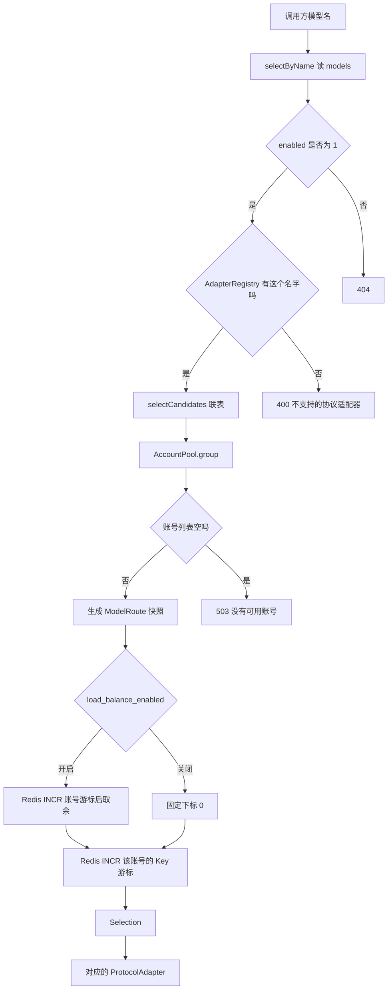

# 第 5 课：模型路由与适配器

### 1. 本节课我们要学什么？

跟着「一个模型名」走进数据库，看它怎样变成一份不可变的 `ModelRoute`，再变成某一个账号和某一把 Key，最后落到 `OpenAiChatAdapter` 或 `DashScopeWanAdapter`。

学完你应该能回答：停用一个 Key 后，下一次请求为什么不用重启；同一次 500 重试为什么不会把别的用户的轮询也跳过一格。

### 2. 先讲一个生活中的例子

酒店前台接到电话：「我订的是园景房。」前台不会把这句话直接喊给所有楼层。他做三件事。

查今日房价牌：园景房还卖不卖，这种房型由哪一支服务队负责（适配器），房间地址写在哪一行。

看服务队此刻接不接客：这一分钟满了没有，这支队伍是不是连续出问题被暂停。

从允许接这种房型的几张前台工号里轮流派一位，再从他口袋的几把房卡里轮流拿一把。如果客人中途说「这把卡开不了门」，前台改派下一位，但墙上的「下一次轮到谁」不因为这次补救而多跳一格。否则后面正常的客人会永远遇不到刚才那位。

房价牌是 MySQL。墙上的圆盘计数是 Redis。派工的人是负载均衡。拿着房卡去开门的人是适配器。

### 3. 为什么需要这个技术？

模型名只是调用方的一句话。真正发 HTTP 需要五样东西：协议实现、完整 URL、上游模型名、账号、API Key。少任何一样，请求都不该出网。

如果在控制器里写：

```text
如果模型是 deepseek-flash，URL 是某某，Key 是某某
如果模型是 qwen-max，URL 是某某
```

每加一个模型就要改代码、发版。Key 还会进 Git。现在这些都在表里，管理页可以改。进程只读配置，启动时不插入供应商和模型。

如果适配器自己去查库选 Key，每家厂商都会复制「停用的不要、别的供应商的账号不要」。所以选路集中在 `routing` 包，适配器只接受已经选好的 `Selection`。

### 4. 技术原理

路由在这里不是网关软件里那种「路径前缀转发」。它是：用调用方给的模型名，找出这一次允许使用的全部材料，收成一个对象。

这个对象叫 `ModelRoute`，是 Java 的 `record`。record 的字段在构造之后不再提供 setter。构造时还执行了 `accounts = List.copyOf(accounts)`，外面的人即使还握着原来的 List，也改不了快照里面那份。同一次请求的重试继续用它，所以不会出现「第一次看见两个账号，第二次有人停用，列表突然变了」。下一次新的 HTTP 请求会重新 `resolve`，停用立刻生效。

账号的挑选是平滑轮询，不是随机。Redis 里一个整数不断加一。第 n 次加一得到 n，下标是 `(n - 1) % 账号数`。三个账号时连续请求落到 0、1、2、0。并发时每人加一，所以倾向于分到不同位置。这不是绝对公平到每一个毫秒，只是轮流。

负载均衡开关关掉时，不读账号游标，永远用下标 0。SQL 已经 `ORDER BY pa.id ASC`，下标 0 就是 id 最小的可调度账号。Key 的游标照样加一。关掉的是「换账号」，不是「换 Key」。

### 5. 放到我们的项目中

`RouteResolver.resolve` 的四步，对应四句拒绝的人话。

1. `catalog.findModel`。MyBatis 执行 `ModelCatalogMapper.xml` 的 `selectByName`。SQL 故意包含停用模型，这样「从来没有这个名字」和「有但停用了」都能变成同一种 404。调用方不需要区分这两种内部原因，只要别继续打上游。行是 `ModelRow`。
2. `adapters.find(adapterName)` 为空则 400。适配器是代码里的 Bean，不是表里随便写的字符串。表里写了 `gemini-native` 但没人实现这个类，就在这里拦住。
3. `catalog.findEligibleAccounts`。SQL `selectCandidates` 同时要求：`model_accounts.enabled = 1`，账号 `enabled = 1`，账号的 `provider_id` 等于模型的供应商，Key `enabled = 1`。四者缺一，这把 Key 不会出现。结果按账号 id、Key id 升序。`AccountPool.group` 把扁平行收成「一个账号带着多把 Key」。例如两行都是账号 3，就变成账号 3 下面两把 Key；下一行账号 5 成为列表里的第二个账号。列表空则 503。
4. 上游名为空或只有空白时，用调用名。然后 `new ModelRoute(...)`。RPM 小于等于 0 或空，在这里变成 `null`，表示不限制请求数。TPM 同样收成 `null` 或原值放在快照上，准入不读取。

可调度的定义要能背下来。只把账号停用，或只把模型和账号的链接停用，或只把 Key 停用，效果都是：下一次新请求的快照里没有它。同一次已经开始的请求仍用旧快照。

选中之后，`Selection` 带四样东西：整份 `ModelRoute`、选中的 `AccountCandidate`、选中的 `ApiCredential`、这个账号在列表里的下标。`toString` 只打印模型名、账号 id、Key id，不打印 Key 原文。日志用得上它，又避免把钥匙打进日志。

适配器不参加上面任何一步。`AdapterRegistry` 在启动时收到 Spring 注入的 `List<ProtocolAdapter>`。现在这个列表里就是两个 `@Component`：`OpenAiChatAdapter` 和 `DashScopeWanAdapter`。注册表用 `name()` 做 Map 的键。两个类如果返回同一个名字，启动时 `toUnmodifiableMap` 会抛异常，进程起不来。这是故意的，重名比静默覆盖安全。

对话编排拿到路由后调用 `adapters.required(route.adapterName())`。正常情况下 `resolve` 已经确认过名字存在，这里是第二道保险。

### 6. 核心代码逐段讲解

文件：`src/main/java/com/llmgateway/routing/RouteResolver.java`，方法 `resolve`。

```java
ModelRow row = catalog.findModel(modelName);
if (row == null || row.getEnabled() != 1) {
    throw new GatewayException(404, ErrorTypes.NOT_FOUND, "模型不存在或已停用");
}
if (adapters.find(row.getAdapterName()).isEmpty()) {
    throw new GatewayException(400, ErrorTypes.INVALID_REQUEST, "不支持的协议适配器");
}
List<AccountCandidate> accounts = catalog.findEligibleAccounts(row.getId(), row.getProviderId());
if (accounts.isEmpty()) {
    throw new GatewayException(503, ErrorTypes.SERVER_ERROR, "没有可用的供应商账号");
}
```

`findModel` 的实现是 `DbModelCatalog`，它把调用转给 Mapper，自己不加缓存。所以没有「本地缓存了旧的 enabled」这一层。你在管理页把模型停用，下一次 `selectByName` 就能看到 `enabled = 0`。

轮询的第一跳在 `RoundRobinAccountLoadBalancer.select`：

```java
int index = route.loadBalanceEnabled()
        ? index(cursor.increment(RedisKeys.accountCursor(route.modelId())), accounts.size())
        : pinnedIndex(accounts.size());
AccountCandidate account = accounts.get(index);
return new Selection(route, account, pickKey(route.modelId(), account), index);
```

`cursor.increment` 的生产实现是 `RedisRotationCursor`。它只做 Redis `INCR`。失败时抛 503，「轮询计数不可用」，不会退回到本进程的一个普通计数器。注释说明了原因：如果退回本地计数，多台网关会各自从 0 开始，同一个账号被同时打满。

`index` 方法是 `floorMod(incremented - 1, size)`。INCR 第一次返回 1，下标 0。这就是「第 n 次得到下标 n-1」。

同一次请求的补救在 `nextAccount`：

```java
if (accounts.size() < 2) {
    return Optional.empty();
}
int index = (current.accountIndex() + 1) % accounts.size();
```

这里没有 `cursor.increment`。下标只在这次快照里加一。`pickKey` 仍会 INCR Key 的游标，因为换了账号之后，仍要在新账号的 Key 里轮换。

视频查询回到旧账号用 `selectKey`。它在快照里按账号 id 找。找不到就 503，「创建任务的账号已不可用」。找到了也要 `pickKey`，所以同一账号的多把 Key 仍会轮换。

打开负载均衡时，管理端要求当前可调度账号至少两个，否则 `AdminService` 返回 400，库里的开关不变。这是管理接口的规则。运行时如果后来只剩一个账号，请求仍打到这一个，不会自动把开关改回关闭。一个都没有，仍然是 `resolve` 里的 503。

适配器侧，文本发车前只改两处，见 `OpenAiChatAdapter.invoke` 的前几行：`JsonBodies.replaceModel` 把 `model` 覆盖成 `upstreamModelName`；请求头放 `Authorization` 和 `Content-Type`。调用方自己带来的 Authorization 根本不会被复制。URL 是 `URI.create(route.baseUrl())`，没有拼接路径。

视频创建多一个头：`X-DashScope-Async: enable`。查询则走 `TaskUris.query`，方法是 GET，没有正文。

`replaceModel` 还会防止调用方在 JSON 里写另一个模型名、借这次选中的地址和 Key 去打别的模型。无论调用方写什么，发出去之前都盖成表里的上游名。

### 7. 配图理解

从模型名到厂商 HTTP：



逐步看。

1. 404、400、503 都在生成快照之前或当时结束，不会出现 `Selection`。
2. 负载均衡只影响账号下标从哪来。两条路最后都要选 Key。
3. `Selection` 交给适配器之后，适配器不再回到这张图的左边查库。

三个账号、负载均衡开启时的下标：

| INCR 返回值 | 计算 | 账号下标 |
| --- | --- | --- |
| 1 | (1-1) % 3 | 0 |
| 2 | (2-1) % 3 | 1 |
| 3 | (3-1) % 3 | 2 |
| 4 | (4-1) % 3 | 0 |

如果这时停用了中间那个账号，下一次新请求的列表长度变成 2。游标不会被改写。假设下一次 INCR 得到 5，下标 `(5-1) % 2 = 0`。旧的「下标 1 是谁」这个含义消失了，只会跳号，不会崩溃。

### 8. 常见误区

- 「`AdapterRegistry` 会 new 一个适配器。」不会。对象是 Spring 在启动时创建的单例，注册表只是按名字放进 Map。一次请求不会新建适配器。
- 「轮询是每个账号一个后台线程在抢。」不是。没有后台轮询线程。谁的请求进来，谁把 Redis 整数加一。
- 「Key 轮换和账号轮换是同一个 Redis 键。」不是。账号键是 `llm-gateway:rr:model:{modelId}:account`。Key 键是 `llm-gateway:rr:model:{modelId}:account:{accountId}`。
- 「上游模型名可以靠调用方 JSON 随便指定。」发出去之前会被 `replaceModel` 盖掉。选路用的地址和 Key 跟这行模型绑定，不能被正文里的另一个名字借走。

### 9. 本节课总结

路由把数据库里的一行变成一次请求的快照。快照里的账号已经过滤过启用状态和供应商。负载均衡在快照上取下标，游标只放 Redis。适配器是按 `adapter_name` 找到的现成对象，它只负责把快照里的 URL 和 Key 变成 HTTP。

### 10. 课后练习

入门：一个模型挂了两个账号，但第二个账号的 Key 全部停用。它还会出现在快照里吗？

参考答案：不会。`selectCandidates` 要求 `ak.enabled = 1`。这个账号没有任何一行能查出来。`AccountPool.group` 也就不会有它。如果因此一个账号都不剩，`resolve` 返回 503。

进阶：负载均衡开启，快照里有账号 A、B。这次请求选中 A 之后上游返回 500，`nextAccount` 改用 B。Redis 账号游标加了几次？

参考答案：加了一次，发生在 `select` 里的 `cursor.increment`。`nextAccount` 只用 `accountIndex + 1`，不再 INCR 账号键。否则后面的用户会跳过本来轮到的人。B 的 Key 游标会在 `pickKey` 里加一。

实战：想让字节的 OpenAI 兼容接口接入，不要新写适配器。你要在管理页得到哪几样东西，运行时哪段代码会用到它们？

参考答案：一条 `models`：`adapter_name` 为 `openai`，`base_url` 为对方的完整 Chat Completions 地址，`model_name` 给调用方用，`upstream_model_name` 为对方真正的模型名。再加上属于该供应商、且挂到 `model_accounts` 的启用账号和启用 Key。运行时 `RouteResolver` 读到这行，`AdapterRegistry` 找到现成的 `OpenAiChatAdapter`，`invoke` 把请求 POST 到这行 `base_url`。不需要改 Java，除非对方不是这套协议。
