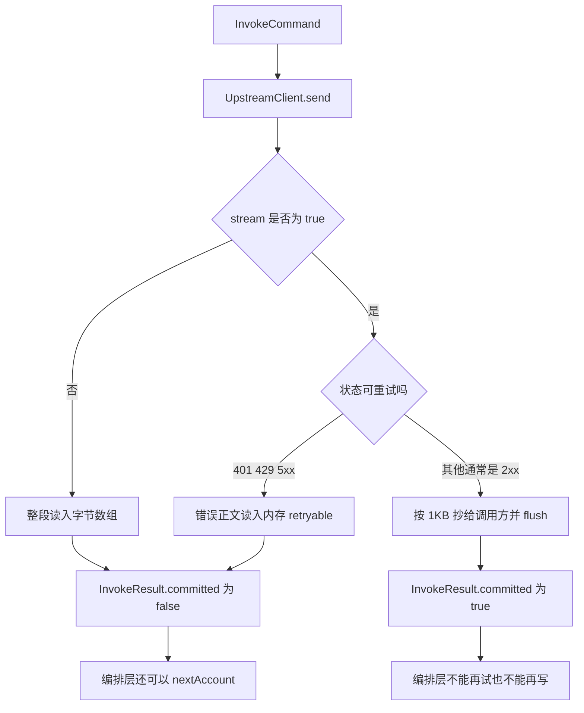

# 第 6 课：模型调用与响应处理

### 1. 本节课我们要学什么？

看已经选好的账号怎样变成一次真实的 HTTP，普通 JSON 和 SSE 有什么差别，超时在什么时刻生效，响应怎样回到业务系统，以及 `model_tasks` 那一行是什么时候写进去的。

学完你应该能解释：为什么流式不能等模型全部生成完；为什么网关超时不等于上游停了。

本项目没有图像生成。这一课不编造画图流程。视频也不走流式，创建和查询都是整段 JSON。

### 2. 先讲一个生活中的例子

你打电话点菜。

电话拨通之前的等待，是连接。餐厅总机若十秒都不摘机，你就挂了，不会把「等菜」的两分钟全耗在占线上。这是连接超时。

电话接通之后，你等厨师把一桌菜一次端出来。等了太久你挂电话。这是整次读取超时。挂电话不等于厨师把锅灭了，菜可能还在做，餐厅可能还是按这桌计费。你再打一次，可能变成第二桌。

另一种吃法是火锅传送带：厨师每做好一片就送出来。你不希望店员在后厨把整晚的菜备齐再开门。传送带开始转之后，你已经吃到第一片，店员就不能再假装没送过、改找另一家店重做一桌。如果传送带转到一半你不吃了，已经送出来的收不回。

普通对话是端整桌。`stream: true` 是传送带。视频创建是先给你一张叫号单，菜要等两小时，不在这次电话里端出来。

### 3. 为什么需要这个技术？

模型生成文字常常要几十秒。如果网关把上游的连接一直占着，线程和调用方的连接都会被拖住。所以每次调用有一份等待预算。

预算又不能只写死在适配器里。业务方有的只要 5 秒的分类，有的要 60 秒的长文。所以预算来自请求头 `X-Gateway-Timeout-Ms`，缺省才用 `gateway.default-timeout-ms`，默认 120000。适配器只负责遵守传进来的 `Duration`。

流式如果先在网关收齐再返回，调用方看到的体验和普通 JSON 一样，第一个字要等最后一个字。网关白做转发。所以 2xx 的流要从上游读到一块就写出一块。

同时也不能对流式的 401 立刻开始写。那时候还可能换账号。所以适配器先看状态码：可重试的错误把正文读进内存，标记 `retryable`，一个字节都不给调用方。

### 4. 技术原理

这里的 HTTP 客户端不是 Axios，也不是测试里才出现的 OkHttp。生产代码用的是 JDK 自带的 `java.net.http.HttpClient`，包在 `UpstreamClient` 里。你可以把它当成服务器端的 Axios：组请求、发出去、拿状态码和正文。差别是它跑在 Java 进程里，并且要区分「整段字节」和「还没读完的输入流」。

`HttpClient` 上有连接超时，来自 `gateway.connect-timeout-ms`，默认 10000 毫秒。它限制的是 TCP 连上对方之前。请求对象上还有 `timeout`，来自这一次的业务预算，限制的是这一次 `send` 等待响应的时间。注释写明：流式时，这个 timeout 只约束到响应头。正文如果一直不结束，要靠 `ResponseWriter.copyStream` 里的截止时间自己断开。

客户端配置了 `followRedirects(NEVER)`。不跟着 302 跑，是为了防止 `Authorization` 被带到另一个主机。

两种失败被翻译成网关自己的错误，而不是把 Java 的异常堆栈丢给调用方。

- `HttpTimeoutException` 变成 504，「上游调用超时」。
- 连接失败的 `IOException`，以及等待被中断，变成 502，「上游连接失败」。

这两种都不在适配器里换账号。编排层只对「已经有 HTTP 状态，且状态是 401、429 或 5xx」重试。超时没有 HTTP 状态，重试可能让上游做两次，所以当前策略是不重试。

SSE 是 Server-Sent Events。响应头 `Content-Type: text/event-stream`，正文是一块块事件，常见内容里带着模型新生成的几个字，最后往往有一块表示结束。它仍是一条 HTTP 响应，不是 WebSocket。普通 JSON 是正文一次性给完。SSE 是同一条响应里分多次写出。

本项目的流式实现是转发，不是解析。`OpenAiChatAdapter` 不把 SSE 拆成「第一句你好、第二句我是」。它按最多 1KB 的缓冲把上游字节抄给调用方。事件的边界由上游决定，网关保持原样。

### 5. 放到我们的项目中

非流式文本、视频创建、视频查询，以及流式但状态可重试的错误，都走 `InvokeResult.buffered`。`committed` 是 false。编排层在重试判断结束之后，才调用 `ResponseWriter.writeBuffered`。它设置状态码、`Content-Type`，把字节数组写进 `HttpServletResponse`。

流式 2xx 走另一条。适配器自己 `response.setStatus`、`setContentType("text/event-stream")`，然后 `ResponseWriter.copyStream`。返回 `InvokeResult.streamed`，`committed` 是 true，`retryable` 是 false，`body` 是 null。编排层看到 `committed`，跳过 `writeBuffered`，避免把响应写第二遍。

`reportedTotalTokens` 只有 `OpenAiChatAdapter` 实现了。它在缓冲的正文里读 `usage.total_tokens`。流式结果的 `body` 是 null，所以返回空。视频适配器没有覆盖这个方法，接口默认返回空。累计到 `models.consumed_tokens` 时，有真实值用真实值，没有就用估算。这个估算不参与限流，网关也不按 Token 拒绝。失败、限流、熔断不累加。累加失败只打日志，不把已经成功的调用改成 503。

任务行在 `CallRecords.record`。规则是：

- 正文能解析出 `output.task_id`，用它当主键。视频创建就是这样。
- 解析不出，用 `UUID`。文本每次都是新的一行，同一句话不会合并。
- 有 `output.task_status` 就用它，例如 `PENDING`。
- 没有的话，HTTP 2xx 记 `SUCCEEDED`，其余记 `FAILED`。

插入 SQL 在主键冲突时只更新 `task_status`，不改账号、不改模型名。查询路径不插入，用 `updateStatus`。

超时和连接失败走 `recordFailure`：没有上游正文，生成一个 UUID，状态固定 `FAILED`。这只发生在对话和视频创建的 `call` 方法里。视频查询的超时不插入、不把旧状态改掉。

日志在写出之前或流式已经写出之后打一行。字段有操作名、模型、账号 id、Key id、状态码、耗时毫秒。`UpstreamClient` 的失败日志只记主机名，不记带 Key 的 URL，也不把 Key 放进异常信息。`GatewayException` 的 message 会返回给调用方，所以同样不能带 Key。

### 6. 核心代码逐段讲解

发出请求的唯一出口是 `UpstreamClient.send`。

```java
HttpRequest.Builder builder = HttpRequest.newBuilder(uri).timeout(timeout);
headers.forEach(builder::header);
if ("GET".equals(method)) {
    builder.GET();
} else {
    builder.POST(HttpRequest.BodyPublishers.ofByteArray(body == null ? new byte[0] : body));
}
```

对话和视频创建走 POST。视频查询走 GET，body 被忽略。`stream` 为 true 时，响应体用 `BodyHandlers.ofInputStream()`，拿到的是还能继续读的流。为 false 时用 `ofByteArray()`，方法返回时正文已经在内存里。

流式分支在 `OpenAiChatAdapter.invoke`：

```java
long deadline = System.nanoTime() + command.timeout().toNanos();
try (UpstreamReply reply = client.send(uri, "POST", headers, payload, command.timeout(), true)) {
    if (JsonBodies.retryableStatus(reply.status())) {
        byte[] errorBody = readAll(reply.stream());
        return InvokeResult.buffered(reply.status(), "application/json", errorBody, true);
    }
    response.setStatus(reply.status());
    response.setContentType("text/event-stream");
    ResponseWriter.copyStream(reply.stream(), response.getOutputStream(), deadline);
    response.flushBuffer();
    return InvokeResult.streamed(reply.status());
}
```

`deadline` 在发请求之前就用这次预算算好。`copyStream` 每读到一块，先看 `System.nanoTime()` 是否已经超过它。超过就抛 504。注意这个检查放在 `read` 成功之后、写给调用方之前。如果 `read` 自己一直阻塞，要靠前面 HTTP 客户端等到响应头的那个 timeout，以及连接本身的行为。代码没有单独再做「读每一块最多等多少毫秒」的 socket 读取超时。这是当前实现的边界，讲的时候不要说成「每一块都有独立的读超时」。

`copyStream` 的缓冲是 1024 字节，写出后立刻 `flush`。flush 的意思是让缓冲区里的字节尽快进入网络，而不是等攒满再送。否则调用方仍会觉得一卡一卡到最后才出来。

`setContentType("text/event-stream")` 之前的注释特别提醒：不要 `setCharacterEncoding`。容器会把 charset 拼进 Content-Type，调用方就看不到纯的 `text/event-stream`。非流式的 `writeBuffered` 则设置了 UTF-8，因为那是普通 JSON。

流式抄到一半如果抛了 504，响应多半已经 `isCommitted()`。`GatewayExceptionHandler` 看到已提交，就不再改状态码、不再写一份错误 JSON，只打一行 warn。调用方可能已经收到前半段 SSE，然后连接断了。这是流式的真实结果，不是网关还能补一个整齐的 `error` 对象的场景。

视频查询的 URL 拼装：

```java
return new URI(base.getScheme(), null, base.getHost(), base.getPort(),
        "/api/v1/tasks/" + taskId, null, null);
```

用户信息、查询串、片段都被丢掉，只留协议、主机、端口，路径换成任务路径。任务号里的斜线已经在前面拒绝。

### 7. 配图理解

非流式和流式在适配器内部分叉：



用三个字的例子看流式成功。假设上游依次产生三段，网关不解析文字，只是字节陆续到达：

1. 上游写出包含「你好」的那一块。`copyStream` 读到，立刻 flush 给业务系统。业务系统已经能显示「你好」。
2. 下一块包含「，我是」。同样立刻转发。
3. 下一块包含「AI 助手。」然后上游关闭流。`read` 返回 -1，循环结束。适配器返回 `streamed`。

业务系统不需要等第三段才看到第一段。网关内存里也没有把三段拼成一个完整字符串再解析。所以网关无法在流式成功之后告诉你 `usage.total_tokens`，除非以后改成边转发边扫描 SSE。当前没有做。

超时的时间线用 30 秒预算举一个具体例子。

| 时刻 | 网关 | 上游模型 |
| --- | --- | --- |
| 0 秒 | 发出 POST，`HttpRequest.timeout` 为 30 秒 | 开始生成 |
| 30 秒 | `HttpTimeoutException`，返回 504，记熔断失败，不换账号 | 代码没有发送取消。对方可能还在生成，也可能还会计费 |
| 30 秒之后业务方再点一次 | 这是新的请求，新的估算、新的限流计数、新的任务行 | 可能和上一次重叠 |

所以「超时」要拆成四个问题，不要混成一个词：网关等多久；连接握手最多多久；超时后有没有通知上游停止；超时后会不会自动再打一次。本项目的答案依次是：请求头或默认 120 秒；默认 10 秒连接超时；不通知取消；不自动重试。

### 8. 常见误区

- 「`stream: "true"` 字符串会开流式。」不会。`asBoolean(false)` 只把 JSON 布尔 true 当成真。字符串走默认 false。
- 「网关把 SSE 转成自己的 JSON 行。」不转。原样抄字节。业务方要按上游的 SSE 格式解析。
- 「504 表示模型进程崩溃了。」不表示。它只表示网关这一侧不再等。要确认上游是否仍在跑，得看厂商控制台，本仓库没有回查文本任务的接口。
- 「所有调用的 Token 都精确。」只有非流式、且适配器从正文读到了 `usage.total_tokens` 才精确。流式和视频用的是 `字节数 / 4`，至少 1。
- 「有图像适配器，只是没配模型。」代码里没有。`AdapterOperation` 没有图像这项。

### 9. 本节课总结

所有厂商 HTTP 都从 `UpstreamClient` 出去。非流式把正文留到编排层决定写不写。流式在确认不是可重试错误之后边抄边 flush，并因此失去换账号的机会。超时变成 504，连接失败变成 502，两者都不换账号，也都不等于上游已经停止。任务表在拿到 HTTP 结果时写入，文本用 UUID，视频创建用上游任务号。

### 10. 课后练习

入门：连接超时和这次调用的等待预算分别是哪个配置、哪个请求头？

参考答案：连接超时是 `gateway.connect-timeout-ms`，环境变量 `GATEWAY_CONNECT_TIMEOUT_MS`，默认 10000，设在 `HttpClient` 上。等待预算是请求头 `X-Gateway-Timeout-Ms`，不传则 `gateway.default-timeout-ms`，环境变量 `GATEWAY_DEFAULT_TIMEOUT_MS`，默认 120000，设在每一次 `HttpRequest.timeout` 上。

进阶：流式第一块已经 flush，上游接着返回后半段时网关崩溃断开。为什么不能改用另一个账号把整段重做并再写给调用方？

参考答案：调用方已经看到前半段。`committed` 为 true 就是在记录这件事。再换账号会把另一段生成接在半截文字后面，或者需要调用方忽略已经收到的内容。当前代码在写出前就禁止了这条路。另外流式 2xx 的 `InvokeResult` 把 `retryable` 固定为 false。

实战：想把默认等待从 120 秒改成 45 秒，应该改哪里？只改 `OpenAiChatAdapter` 里的某个数字可以吗？

参考答案：改环境变量 `GATEWAY_DEFAULT_TIMEOUT_MS=45000`，或在配置里设 `gateway.default-timeout-ms`。不要在适配器里写死。适配器使用 `command.timeout()`，视频和文本才能一起变。某一次调用也可以只带请求头 `X-Gateway-Timeout-Ms: 45000`，不影响别的调用。连接超时是另一项，不该拿它冒充等待预算。
