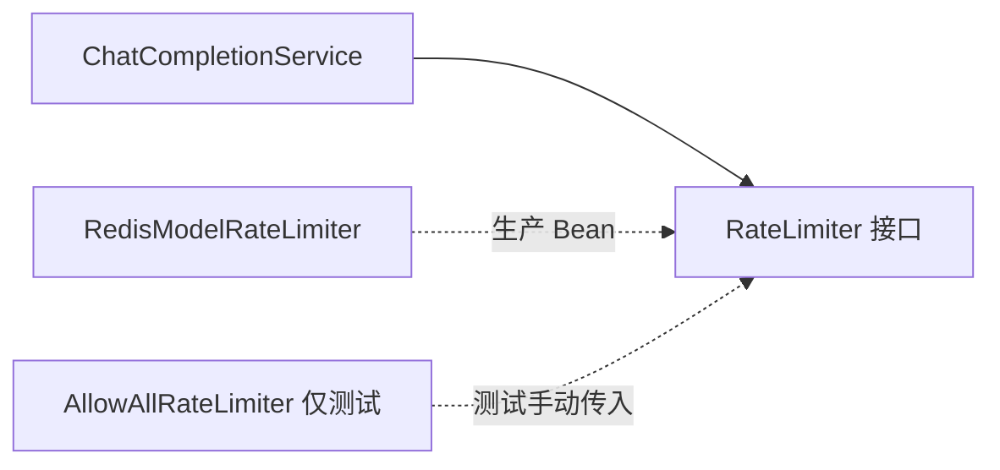
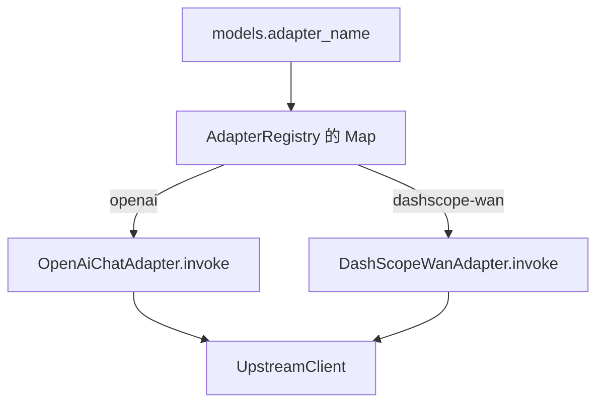
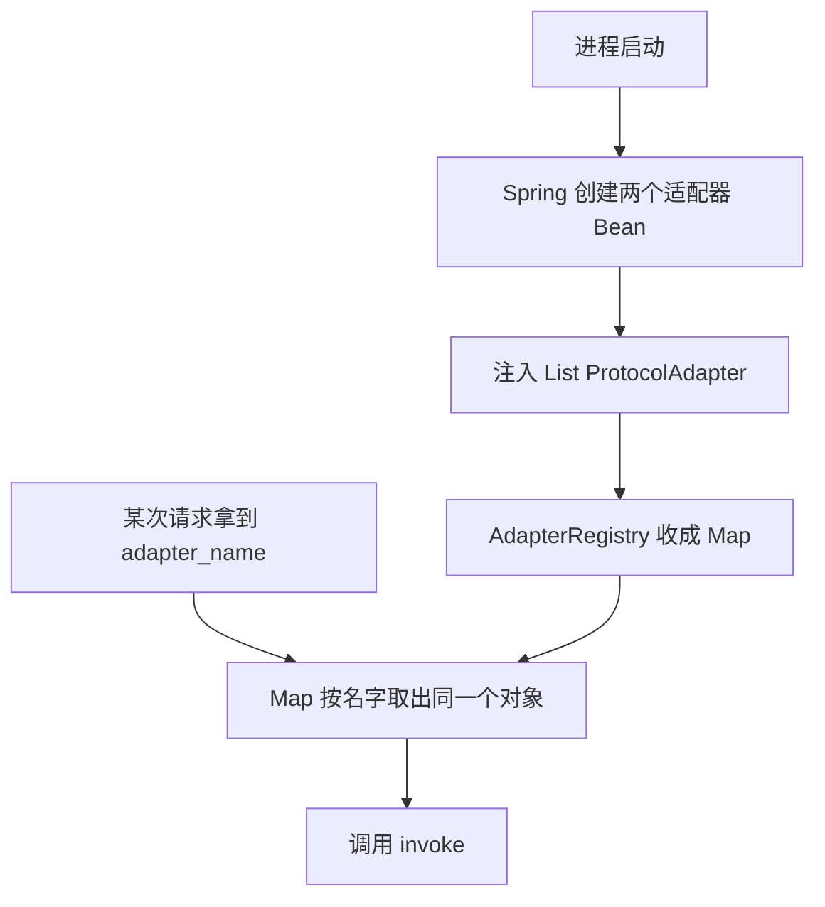
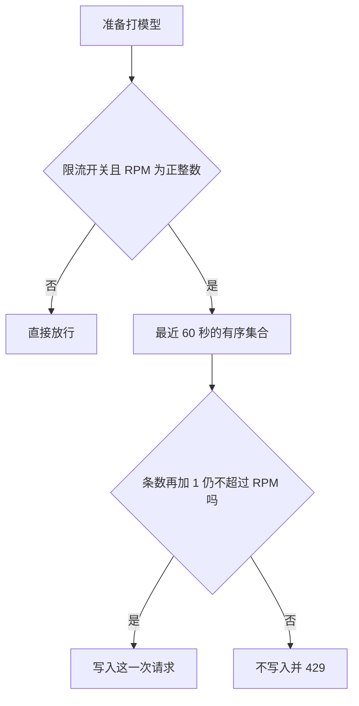
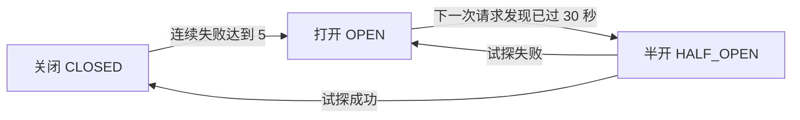
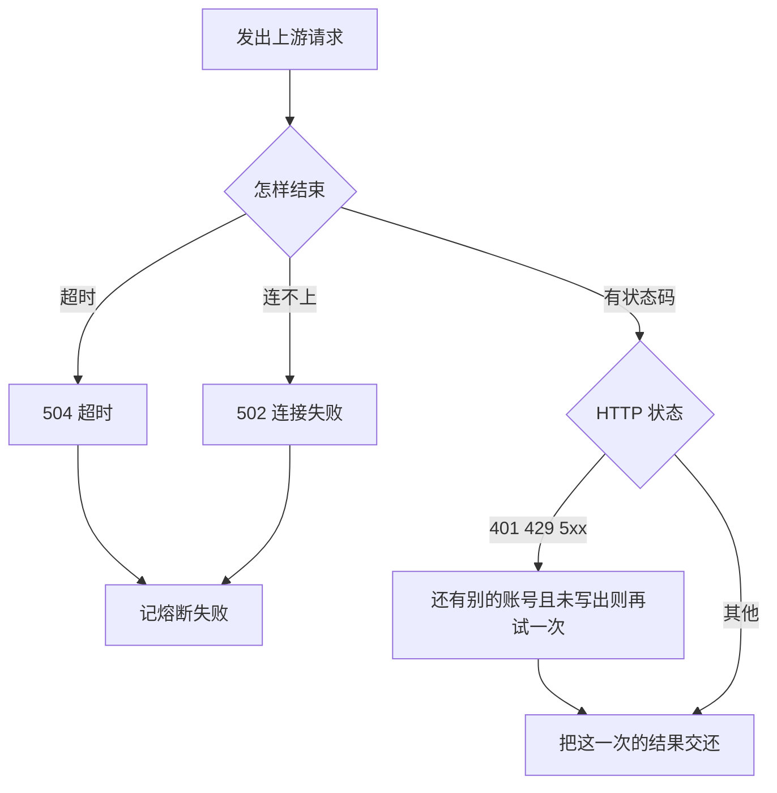
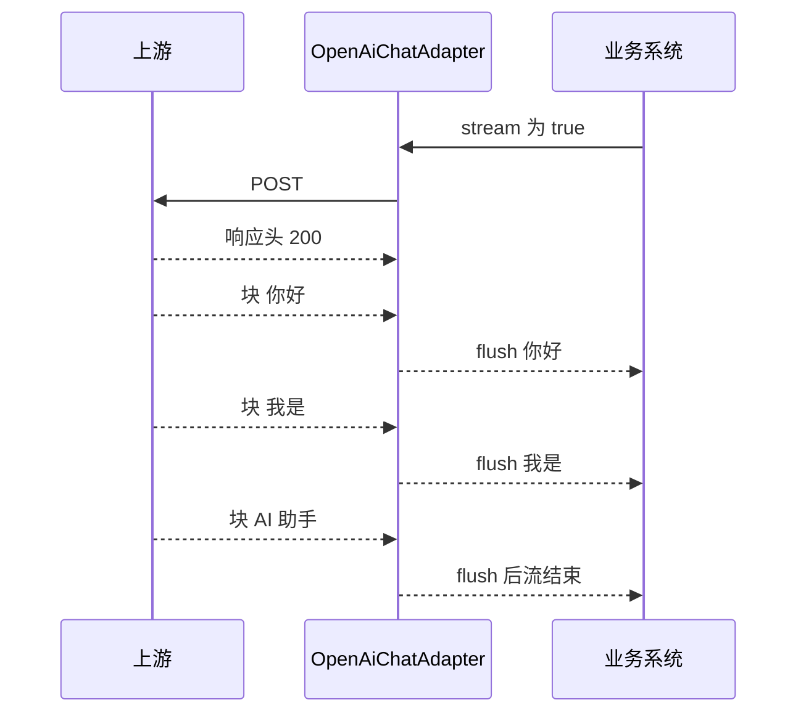

# 第 8 课：核心设计与技术原理

这一课把前面用过的机制再挖一层。每个知识点都按「问题、原理、本项目代码」来，不再把定义单独背一遍。

先记住一句总的区分，避免后面五个词缠在一起。

接口回答「别人可以怎么用我」。策略回答「同一件事有哪几种做法」。注册表回答「按名字拿到哪一种做法」。限流回答「是不是太多」。熔断回答「是不是正在连续出错」。超时回答「我还等多久」。重试回答「这次失败要不要再打一次」。它们在同一次请求里会碰面，但每个词只做自己那一句。

---

## 8.1 接口和实现类为什么分开

### 1. 本节课我们要学什么？

看懂 Java 接口在这个项目里解决的维护问题，并能指出哪些类型是接口、运行时真正干活的是哪个类。

### 2. 先讲一个生活中的例子

办公室的打印机合同写的是：能打印、能查缺纸。行政部可以换品牌，不用改每个员工电脑上的「打印」按钮。按钮依赖的是合同，不是某一台机器的型号。如果按钮里写死了品牌 A 的驱动程序，换品牌 B 就要改所有按钮。

### 3. 为什么需要这个技术？

`ChatCompletionService` 需要限流。如果它的字段类型写成 `RedisModelRateLimiter`，单元测试就得连 Redis，以后换成别的计数方式也要改编排类。现在字段类型是接口 `RateLimiter`。生产放进来的是 `RedisModelRateLimiter`，测试可以放 `AllowAllRateLimiter`。编排类的源码不动。

### 4. 技术原理

接口是一组方法签名，没有业务怎么做的正文。实现类写下方法体。一个类可以 `implements` 接口，表示「我遵守这份合同」。

调用方字段和参数写成接口类型。Spring 看到构造方法要一个 `RateLimiter`，就在容器里找哪个 Bean 是这种类型，传进去。这和「接口本身会 new 对象」无关。接口不能直接 new。

没有接口时，所有分支会堆进编排类：如果是 Redis 就怎样，如果是测试就怎样。每加一种存储，编排类就改一次。有了接口，新的实现类自己实现方法，编排类仍调用 `inspect`。

接口不神秘，也不是文件多就高级。这个项目只在「确实有或明确准备有第二种做法」的地方用它：协议、限流、熔断、选账号、读模型、记任务、超时。

### 5. 放到我们的项目中

| 接口 | 生产实现 | 编排层为什么只认接口 |
| --- | --- | --- |
| `ProtocolAdapter` | `OpenAiChatAdapter`、`DashScopeWanAdapter` | 发 HTTP 前不知道是哪家协议 |
| `RateLimiter` | `RedisModelRateLimiter` | 不关心计数在 Redis 还是别的地方 |
| `ModelCircuitBreaker` | `RedisModelCircuitBreaker` | 同上 |
| `AccountLoadBalancer` | `RoundRobinAccountLoadBalancer` | 以后可以换加权，服务不用改 |
| `ModelCatalog` | `DbModelCatalog` | 读配置的方式和选路规则分开 |
| `RotationCursor` | `RedisRotationCursor` | 游标存储可替换 |
| `TaskBindingStore` | `DbTaskBindingStore` | 适配器不依赖 MyBatis |
| `TimeoutPolicy` | `HeaderTimeoutPolicy` | 适配器不解析请求头 |
| `TokenUsage` | `DbTokenUsage` | 累加 Token 的 SQL 不进编排判断 |

`AllowAllRateLimiter` 和 `AllowAllCircuitBreaker` 是测试用实现，没有 `@Component`，不会进生产容器。

### 6. 核心代码逐段讲解

`ChatCompletionService` 的构造方法全是接口或稳定类型，没有出现 `OpenAi` 这几个字母：

```java
public ChatCompletionService(ObjectMapper mapper, RouteResolver routes, AdapterRegistry adapters,
                             AccountLoadBalancer loadBalancer, ModelAdmission admission,
                             TimeoutPolicy timeoutPolicy, TaskBindingStore tasks)
```

它调用 `adapter.invoke` 时，变量类型是 `ProtocolAdapter`。运行到 `deepseek-flash` 时，这个对象的真实类是 `OpenAiChatAdapter`。运行到视频时，根本不会进这个服务。

增加一家原生协议的厂商，要新增的是一个 `implements ProtocolAdapter` 的类，并标 `@Component`。`name()` 返回的字符串写进 `models.adapter_name`。`AdapterRegistry` 的构造方法接收 `List<ProtocolAdapter>`，Spring 会把所有实现放进这个列表。注册表不用改，对话服务不用改，除非新协议还需要新的对外路径。如果只是又一家 Chat Completions，连新类都不用写，用现成的 `openai` 名字加一行模型。

### 7. 配图理解



服务只指向接口。哪个实现站到接口后面，由 Spring 或测试代码决定，不由服务里的 if 决定。

### 8. 常见误区

- 「有接口就必须有工厂。」不是。Spring 已经负责创建实现类。第 8.3 节会把这件事说透。
- 「接口里写一点默认方法就等于有了两套业务。」`RateLimiter.reconcile` 保留默认空实现，生产限流不再覆盖它。视频适配器那边的 `reportedTotalTokens` 也是默认返回空。默认方法是「没特殊需要就不用写」，不是第二种策略。

### 9. 本节课总结

接口让编排层依赖「能做什么」，不依赖「Redis 或 OpenAI 具体怎么做」。本项目用它把协议、限流、熔断、选账号和记账拆开。新增原生厂商时，新写一个适配器 Bean，而不是改对话服务的内部分支。

### 10. 课后练习

入门：`ChatCompletionService` 能不能在源码里出现 `new OpenAiChatAdapter`？出现了会有什么问题？

参考答案：现在没有，也不该有。那样对话服务就和某一种协议焊死，测试要构造真实适配器，视频或第二种文本协议无法替换。现在它只向 `ProtocolAdapter` 要 `invoke`。

进阶：为什么 `AllowAllRateLimiter` 不能加上 `@Component`？

参考答案：生产会同时存在两个 `RateLimiter` Bean。Spring 给 `ModelAdmission` 注入时无法确定用哪一个，启动失败，或者在你加了主次注解后悄悄用错。测试类应该由测试自己 `new`，注释里也写了「本类不要标成组件」。

实战：列出新增一家「不是 OpenAI 协议」的文本厂商时要改的代码，以及明确不用改的代码。

参考答案：要新增实现 `ProtocolAdapter` 的类，`name()` 与表里的 `adapter_name` 一致，`supports` 返回对话操作，`invoke` 里按对方协议改请求并调用 `UpstreamClient`。表里加模型和账号。不用改 `ChatCompletionController` 的路径，不用改 `ModelAdmission`，不用改 `RoundRobinAccountLoadBalancer`。如果对方有 Token 字段，覆盖 `reportedTotalTokens`，成功后的 `consumed_tokens` 才能用真实值。这不改变 RPM。

---

## 8.2 策略模式怎样用在适配上

### 1. 本节课我们要学什么？

把策略模式说成一句人话，并沿着一次 `invoke` 看策略是怎么被选中的。

### 2. 先讲一个生活中的例子

同一件「寄出包裹」，同城闪送和国际空运的表格、运单号、时效完全不同。柜台不应该写成三千行 if。柜台只喊「按你选的那种运单寄出」。每种运单是一个策略。

### 3. 为什么需要这个技术？

OpenAI 兼容对话要 `messages` 和 Bearer 头。万相创建要异步头，查询还要换 URL 并改成 GET。如果写在 `ChatCompletionService` 里：

```text
if adapterName 是 openai 就这样拼
else if 是 dashscope-wan 就那样拼
```

第三家来的时候，编排类继续变胖，视频的重试和文本的拼 JSON 混在一个方法里，改一家容易碰坏另一家。

### 4. 技术原理

策略模式是：把可以互相替换的算法各自放进一个类，这些类实现同一个接口，调用方只通过接口调用。选择「用哪一个」可以发生在别的地方。选择本身不是策略模式的全部，很多人把「if 选择」和「算法本体」糊在一起，后面和工厂就分不清。

在这里，算法本体是 `invoke` 里面的差异。选择发生在更早的 `models.adapter_name` 加上 `AdapterRegistry`。

### 5. 放到我们的项目中

两种策略的差异是具体的。

| | `OpenAiChatAdapter` | `DashScopeWanAdapter` |
| --- | --- | --- |
| `name()` | `openai` | `dashscope-wan` |
| 支持的操作 | 只有对话 | 创建和查询 |
| 创建时的方法 | POST | POST |
| 特殊请求头 | 只有 Authorization 和 Content-Type | 额外 `X-DashScope-Async: enable` |
| 查询 | 不支持 | GET，URL 换成 `/api/v1/tasks/{id}` |
| 流式 | 支持，2xx 时转发 SSE | 不看 `stream`，命令里视频也传的是 false |
| Token | 读 `usage.total_tokens` | 用接口默认值，没有用量 |

两边相同的部分故意不放在策略里：选账号、限流、熔断、换账号重试、写 `model_tasks`。那些不是「协议的差异」。

### 6. 核心代码逐段讲解

一次策略调用的真实跳转。

1. `RouteResolver` 从行里取出 `adapter_name`，例如 `dashscope-wan`。
2. `VideoSynthesisService` 调用 `adapters.required("dashscope-wan")`，得到的对象运行类型是 `DashScopeWanAdapter`。
3. 服务先 `supports(VIDEO_CREATE)`。这个方法在万相适配器里对创建返回 true。
4. 服务组装 `InvokeCommand`，操作类型是 `VIDEO_CREATE`。
5. `DashScopeWanAdapter.invoke` 看到不是 `VIDEO_QUERY`，走进 `create`。
6. `create` 替换模型名，加异步头，`client.send` POST 到 `base_url`。

如果模型名是 `qwen-max`，第 2 步得到的是 `OpenAiChatAdapter`，第 6 步不会存在异步头。对话服务甚至不会去调用万相适配器，因为 `supports(CHAT_COMPLETION)` 在万相那边是 false，请求在发车前就 400 了。

没有一个中心 if-else 列举厂商。`if (command.operation() == VIDEO_QUERY)` 是万相适配器内部区分自己的两种操作，不是网关在区分全世界的厂商。

### 7. 配图理解



Map 的键是字符串，值是策略对象。HTTP 出口只有一个，策略只决定头、方法、URL 和正文怎么准备。

### 8. 常见误区

- 「策略模式就是消灭所有 if。」没有。万相适配器里仍有创建和查询的 if。被消灭的是「每加一个厂商就改编排类」的那种 if。
- 「不同厂商的响应会被策略转成统一的 choices 结构。」文本成功时基本是原样返回。视频返回的是万相自己的 `output`。策略没有做一层大而全的统一响应模型。

### 9. 本节课总结

策略是 `ProtocolAdapter` 的不同实现。差异写在 `invoke` 里。编排层只认接口。选哪一个策略由模型行上的名字决定，不由一长串厂商 if 决定。

### 10. 课后练习

入门：用一句话说明策略模式在本项目里替换了什么。

参考答案：替换了编排层里按厂商名拼接 HTTP 的分支。每一种协议一个类，编排层只调用 `invoke`。

进阶：为什么不能把「401 就换账号」写进 `OpenAiChatAdapter`？

参考答案：换账号需要账号列表和「不要推进账号游标」的规则，那是编排和负载均衡的职责。写进适配器后，万相还得再写一遍。而且适配器此时只看到一次 HTTP 结果，看不到「还有没有下一个账号」。现在 `retryable` 只是一个布尔值，决定权在 `ChatCompletionService`。

实战：追踪 `wan2.6-t2v` 的创建请求，说出从 `supports` 到 `UpstreamClient.send` 之间经过的方法名。

参考答案：`VideoSynthesisService.create` 里 `prepare` 调用 `supports(VIDEO_CREATE)`。之后 `createCommand` 得到 `InvokeCommand`。`call` 进入 `DashScopeWanAdapter.invoke`，再进私有方法 `create`，其中调用 `client.send`。

---

## 8.3 工厂在这个项目里到底有没有

### 1. 本节课我们要学什么？

分清策略模式和工厂模式，并诚实说出本仓库的做法。不要为了面试话术虚构一个不存在的 `AdapterFactory`。

### 2. 先讲一个生活中的例子

策略是不同的运单。工厂是柜台背后那个「根据你说的同城或国际，把对应运单本拿出来」的人。你可以有策略而没有一个叫工厂的岗位：运单本在早上已经按名字放进格子，柜台只按名字取。本项目更接近格子，而不是现做一份运单。

### 3. 为什么需要这个技术？

教科书里的简单工厂解决的是：调用方不要自己 `new` 具体类，也不要自己写 if 决定 new 谁。本项目同样不希望 `ChatCompletionService` 写 `new OpenAiChatAdapter`。

但它没有用一个工厂方法在每次请求里 new。适配器没有请求级的状态，启动时各创建一个对象，之后反复使用，是安全的。每次 new 只会增加垃圾对象，没有好处。

### 4. 技术原理

工厂模式的重点是「创建对象的责任集中在一处」。策略模式的重点是「算法可以替换」。一个工厂可以创建策略对象，然后调用方执行策略。两者可以配合，但回答的不是同一个问题。

配合时的分工：

- 工厂或注册表：给我一个名字，还我一个对象。
- 策略：拿到命令后，按我的规矩执行。

本项目的创建发生在 Spring 启动。`@Component` 让 Spring 调用构造方法，传入 `UpstreamClient` 和 `ObjectMapper`。`AdapterRegistry` 只在自己的构造方法里把现成列表收成 Map。它是注册表。面试时可以说：效果上相当于把简单工厂的「按名字获取」交给了 Spring 容器加注册表，请求路径上没有工厂方法。

如果面试官追问「那工厂在哪」，正确的回答是指出 `AdapterRegistry` 的构造方法和 `required`，并说明对象生命周期是单例，不是每次请求创建。不要声称有 `createAdapter()`。

### 5. 放到我们的项目中

`AdapterRegistry` 构造方法：

```java
public AdapterRegistry(List<ProtocolAdapter> adapters) {
    this.byName = adapters.stream()
            .collect(Collectors.toUnmodifiableMap(ProtocolAdapter::name, Function.identity()));
}
```

`required` 按名字取出，没有就 400。`all` 按名字排序，给管理页 `GET /admin/api/adapters` 用。新适配器只要是 Bean，这个列表会自己变长，管理页下拉不用改前端硬编码。

新增适配器的实际步骤：

1. 写类，实现 `ProtocolAdapter`，加 `@Component`。
2. 保证 `name()` 唯一。
3. 在模型表使用这个名字，并配上地址和账号。
4. 重启进程，让 Spring 创建新 Bean。只改数据库不会凭空出现新的 Java 类。

OpenAI 兼容的新地址连第 1 步都不要，因为它不是新策略，只是同一策略的新配置。

### 6. 核心代码逐段讲解

获取适配器的过程没有分支创建。`find` 就是 `Map.get`。

```java
public Optional<ProtocolAdapter> find(String name) {
    return Optional.ofNullable(byName.get(name));
}
```

`RouteResolver` 用 `find(...).isEmpty()` 决定 400。服务层用 `required` 再取一次来调用。两次都是查 Map，不是两次 new。

### 7. 配图理解



上半段每个进程只发生一次。下半段每次请求都发生。中间没有工厂在请求里制造新对象。

### 8. 常见误区

- 「注册表就是工厂，两个词可以混用。」面试时会减分。创建时机和职责不同。你可以说注册表承担了按名字查找的那一部分职责。
- 「新增适配器不用重启。」Java 类要进进程，必须重新启动，除非你们另有热加载，而本项目没有。新增模型行不用改代码，但若只是新 URL 加旧适配器，重启也不是必须的，因为每次请求都查库，类已经在 Map 里。

### 9. 本节课总结

策略负责「怎么发」。注册表负责「按名字拿已经创建好的策略」。Spring 负责「启动时创建」。本项目没有经典的请求级工厂类。讲的时候把这三句分开，就和教科书对得上，也不会和代码打架。

### 10. 课后练习

入门：策略模式和工厂模式各用一句话说明它解决的问题。

参考答案：策略解决「同一动作有多种可替换做法，调用方不要写满分支」。工厂解决「调用方不要自己决定 new 哪一个具体类」。本项目的做法是 Spring 创建、注册表按名字查找，查找的结果拿去执行策略。

进阶：为什么适配器做成每个进程一个对象是可以的？什么情况下就不能这么做？

参考答案：现在的适配器字段只有 `UpstreamClient` 和 `ObjectMapper`，`invoke` 用的数据都在参数 `InvokeCommand` 里，没有把「当前用户的 Key」存在字段上。所以多个请求同时调用同一个对象是安全的。如果有人把本次请求的 Key 存进适配器字段，并发就会串单，那时候才需要每次创建或改回局部变量。

实战：两个类都把 `name()` 写成 `openai`，启动会怎样？

参考答案：`AdapterRegistry` 构造方法里的 `toUnmodifiableMap` 遇到重复键会抛异常，Spring 启动失败。这是故意的。不会默默用其中一个。

---

## 8.4 限流算法，以及本项目实际用了哪一种

### 1. 本节课我们要学什么？

能用「每分钟 60 次」把四种常见算法讲出差别，并明确说出仓库现在用的是滑动窗口。

### 2. 先讲一个生活中的例子

路口每分钟放行 60 辆车。

固定窗口：整点到下一整点算一分钟。10:00:59 放了 60 辆，10:01:00 又放 60 辆。

滑动窗口：永远看「现在往前推 60 秒」。10:01:00 仍记得 10:00:59 那一批，不会立刻再放 60 辆。

令牌桶：桶里最多存 60 个令牌，每秒恢复 1 个。车来了就取走一个。桶里有存货时可以一下通过多辆，但长期平均仍是每秒 1 辆。

漏桶：车进队列，出口按固定速度放行。进来太猛就溢出拒绝。出口是匀的，不会因为桶里有存货就突然放快。

### 3. 为什么需要这个技术？

模型厂商按分钟或按 Token 收费，也会限制速率。网关如果完全不挡，一个客户端就能把共享配额用完。挡的位置必须在打到厂商之前，否则拒绝时钱已经花了。本项目的模型级限流在 `ModelAdmission.enter`。账号已经在 `loadBalancer.select` 里选定，上游还没打。

### 4. 技术原理

四种算法的差别可以压成两句。窗口类看的是一段时间里已经发生的数量。桶类看的是一个随时间补充或泄漏的库存。固定窗口实现简单，边界会突增。滑动窗口要记住窗口里的每一次放行，整点不会突然再放一份满额。令牌桶允许短突发。漏桶把突发抹平。

本项目用滑动窗口。每次放行在 Redis 有序集合里留一条时间。判断前丢掉年龄大于等于 60 秒的记录，只比较请求条数和 RPM。多实例共用这一份集合，读写都在一条 Lua 里。没有令牌桶那种按秒补库存的循环。固定窗口只作为对比：它会在 10:00:59 和 10:01:00 各放满一次，本仓库的脚本不会。

### 5. 放到我们的项目中

实现就是 `RedisModelRateLimiter` 加 `rate-limit.lua`。维度是模型，不是账号，不是调用方。开关 `rate_limit_enabled` 为 0，或 RPM 不是正整数时，不计数，也不碰 Redis。只保存 TPM 同样不计数。

超过限制：429，`rate_limit_error`，文案「模型请求超过限制」。账号已经选定，所以这一轮的账号游标和 Key 游标已经加过。不记熔断，只归还这个账号的半开名额。不写 `model_tasks`，因为还没 `invoke`。

Redis 自己坏了：503，「限流计数不可用」。半开名额会还。不会把这次记成账号失败。账号游标同样已经加过。

### 6. 核心代码逐段讲解

用 RPM 60 走一遍。窗口里已经有 10 条放行。模型上的 TPM 是多少都不管。

- `(10+1) > 60` 为假。
- 写入第 11 条，成员是这次的 `reservationId`，分数是当前毫秒。
- 返回 1，Java 放行。

已经有 60 条时，`(60+1) > 60` 为真，返回 0，不写入。成功响应里的真实 Token 不会改这条记录，也不会把已经记下的请求数减掉。

### 7. 配图理解



窗口不会在整点清零。一条记录要等它自己满 60 秒才离开。12:00:59 放满的 60 次，到 12:01:00 仍然占着额度。

### 8. 常见误区

- 「代码里有令牌桶，因为很多网关都这么写。」没有。不要把行业习惯说成这个仓库的实现。
- 「第 61 次请求仍然会写进集合。」不会。先判断，超了就 return，后面的 `ZADD` 不执行。
- 「限流按账号。」不按。键里只有模型 id，成员是这一次放行。熔断才把账号 id 放进键里。两个账号不会让模型的 RPM 变成两份。

### 9. 本节课总结

四种算法都要能对比。本项目用的是滑动窗口，只保护 RPM，用 Lua 保证要么记下这一次请求，要么完全不记。整点不会再放进第二份满额。拒绝发生在账号已经选定之后。令牌桶和漏桶没有实现。网关不执行 TPM。

### 10. 课后练习

入门：RPM 为 60。为什么 12:00:59 放满 60 次之后，12:01:00 的下一次仍然会被拒绝？

参考答案：窗口是从当前时刻往回 60 秒，不是日历分钟。12:01:00 距离 12:00:59 只有 1 秒，那 60 条还在集合里。要等它们的年龄大于等于 60 秒，`ZREMRANGEBYSCORE` 才会删掉，名额才空出来。

进阶：限流开着，RPM 还有余量，模型上的 TPM 配成 1，这次估算 Token 是 400。放行吗？

参考答案：放行。网关不按 Token 拒绝。成员只记 `reservationId`，不记权重。

实战：供应商返回 HTTP 429 和它自己的 TPM 正文，这个模型只有一个可用账号。调用方看到什么？

参考答案：看到这次上游的 429 和那份正文，不是网关的 `rate_limit_error`。有下一个未熔断账号时，会先换一次再决定把哪一次正文交还。

---

## 8.5 熔断器原理

### 1. 本节课我们要学什么？

用保险丝把关闭、打开、半开讲清楚，并对照 `circuit.lua` 走一次打开和恢复。

### 2. 先讲一个生活中的例子

家里每一路灯有自己的保险丝。这一路电流持续过大就熔断，这一路的灯灭了，别的房间还亮着。它不是电表。电表记录你用了多少电，用太多是另一件事，那像限流。保险丝关心的是「这一路是不是已经危险」。

保险丝断了不能把房子焊死。要换上新的，或先试着合一次闸。合闸后灯正常，就恢复。合闸后又跳，就再断开。半开就是「只允许试着合一次闸」。

### 3. 为什么需要这个技术？

上游连续超时 30 秒时，每个新请求都会再占一个 30 秒。网关的线程和调用方一起被拖死，上游也没有喘息。某个账号连续失败后，选路直接跳过它。这个模型上的账号都打开时，请求在几毫秒内 503。冷静期过后对这个账号放一个试探，避免永久拒绝一个已经恢复的账号。

限流挡的是超额的健康流量。熔断挡的是大概率还会失败的流量。限流拒绝不该把保险丝烧断，所以 429 不记失败。

### 4. 技术原理

三个状态。

关闭：正常放行。失败次数在累计，成功会清零。

打开：冷静期内一律拒绝。本项目冷静期默认 30 秒。

半开：只放有限个试探，默认 1 个。成功回到关闭。失败回到打开，冷静期重计。

业界有的实现用失败率，例如 10 秒内 50% 失败。本项目用的是连续失败次数，默认 5。中间来一次 2xx 就会清零，不是「最近 20 次里的 5 次」。

### 5. 放到我们的项目中

状态在 Redis，不在某台机器的内存。多实例看同一份。实现类 `RedisModelCircuitBreaker`，脚本 `redis/circuit.lua`。键是 `llm-gateway:cb:{modelId}:{accountId}`。参数是全局的 `gateway.circuit`，不是每个账号各存一套阈值。每个模型上的每个账号各存一套状态。

没有后台线程。打开到半开的转换发生在下一次选到这个账号时的 `acquire`。

计入这个账号的失败：打到它的连接失败、超时、它自己的 5xx。换到另一个账号时，前一个账号的 5xx 由 `observe` 记下，不会被后一个账号的成功清掉。不计入：网关自己的限流、400 一类、401、上游 429、Redis 轮询失败。这个账号的 2xx 和 3xx 只清它自己的失败次数。

### 6. 核心代码逐段讲解

试探失败的分支：

```lua
if probing == 1 then
  redis.call('HSET', key, 'state', 'open', 'failures', '0', 'openedAt', tostring(now), ...)
  return 1
end
```

Java 在 `fail` 时把 `permit.probing()` 传成 `"1"` 或 `"0"`。半开的一次失败不用再数到 5，立刻打开。

关闭状态下的累计：

```lua
local failures = tonumber(redis.call('HGET', key, 'failures') or '0') + 1
if failures >= threshold then
  redis.call('HSET', key, 'state', 'open', ...)
end
```

达到阈值时失败数被清零，因为已经进入打开状态，次数完成了使命。冷静期结束重新半开时，不会带着一个旧的 5。

### 7. 配图理解



图上的「下一次请求」五个字不能省。没有请求，就没有人把状态从打开改成半开，即使墙上的时钟已经过了 30 秒。Redis 里的字符串会一直是 `open`，直到有人 `acquire`。

### 8. 常见误区

- 「打开之后整个模型都不能用。」只影响这一个模型上的这一个账号。同模型的其他账号继续可被选中。负载均衡关闭时例外：只检查 id 最小的账号，它打开就 503，即使后面还有健康账号。视频查询锁着创建账号，那个账号打开也不改投。
- 「半开会把积压的请求一起放进去试。」默认 `half-open-max-probes` 是 1。第二个并发请求在名额未还、租约未过时会被拒绝。
- 「熔断用了某套开源库。」没有。不要讲 Resilience4j 的滑动窗口配置，那些属性在本项目不存在。

### 9. 本节课总结

熔断器像按账号安装的保险丝，键里还带着模型 id，避免不同模型的同一个账号数字互相覆盖。连续真实失败把它烧断，冷静后再用一个带租约的试探决定要不要合闸。限流的拒绝不烧保险丝。状态在 Redis 的一段 Lua 里改完。

### 10. 课后练习

入门：用保险丝解释为什么熔断之后不能永远 503。

参考答案：保险丝的目的是躲开故障时段，不是宣布这台机器报废。上游可能一分钟后就恢复。所以冷静期结束要允许试探。试探成功就合闸，也就是回到关闭并清零。

进阶：一次 200 发生在失败次数已经是 4 的时候，接下来还要几次失败才会打开？

参考答案：`success` 把 `failures` 设为 0。之后要重新累计满 5 次，不是再来 1 次。

实战：为什么 Key 游标的 Redis 失败用 `release` 而不是 `fail`？

参考答案：游标失败说明计数基础设施不可用，请求还没打到账号。记成失败会让 Redis 的故障把这个账号熔断打开。`RoundRobinAccountLoadBalancer.admit` 在 `pickKey` 抛错时调用 `breaker.release`，只归还半开名额。账号游标的 `INCR` 失败发生在 `acquire` 之前，那时还没有名额。代码里已经没有 `selectOrAbandon`。

---

## 8.6 超时和重试有什么区别

### 1. 本节课我们要学什么？

能画出「30 秒超时」的时间线，并说清哪些情况会换账号，哪些不会。

### 2. 先讲一个生活中的例子

你等外卖 40 分钟没到，取消了订单页面上的等待。骑手可能还在路上。你再下一单，可能两份一起做，两份一起扣钱。如果平台在你取消时没有通知商家停止，取消就不等于没做。

另一些失败适合马上换一家店：这家说会员卡无效。换一家不等于再等 40 分钟的那种不确定，而是对方用 HTTP 明确拒绝了这一次。

### 3. 为什么需要这个技术？

模型生成本来就慢。超时设得太短，正常长回答都会 504。设得太长，故障时线程被占满。

重试能躲开「这一把 Key 坏了」或「这一次上游刚好 500」。重试不能躲开「请求本身 400」，换账号还是 400。重试超时则可能让两家都在做同一件事，费用和限流都双倍，所以本项目超时不重试。

### 4. 技术原理

连接超时：多久连不上就放弃。本项目默认 10 秒，比业务预算短，避免域名不可达时把 120 秒都耗在握手上。

读取或整次等待超时：连上之后多久还没完成。本项目用请求头或默认 120 秒，设在 `HttpRequest` 上。流式正文过长则由 `copyStream` 的截止时间变 504。

超时不等于取消。代码里没有向厂商发取消请求。

重试要同时满足：已经有 HTTP 状态；状态是 401、429 或 5xx；响应还没写给调用方；快照里还有另一个尚未熔断的账号。`nextAccount` 从当前下标往后找，跳过已经打开的账号，找到第一个还能放行的就再打一次 HTTP，不会把每个账号都打一遍。它不增加账号游标，避免一次补救打乱别人的轮次。

不重试的：400 及其他非名单里的 4xx、超时、连接失败、已经开始的 SSE、查询时想换账号（查询只允许 `nextKey`）。

重试和熔断的关系：换到另一个账号之前，`observe` 按前一个账号自己的结果回写。中间那次 500 会给前一个账号记失败；后一次 200 只让后一个账号成功。同一账号换 Key 不 `observe`，只按最后一次 `finish`。两次如果都拿到了 HTTP 响应，任务表会记两次。异常进入 `fail`，记在当时选中的那个账号上。

重试和限流的关系：限流在重试之前已经记过这一次用户请求的 RPM。换账号不再次 `enter`，所以不会因为重试再加一次 RPM。这是当前代码的结果。Token 估算不占限流窗口。

怎样避免重试雪崩：只换一次，不换超时，不在失败时用指数把同一个上游打很多遍。真正挡住「上游已经不行还继续打」的是熔断，不是重试次数。

### 5. 放到我们的项目中

时间线，预算 30 秒，上游其实需要 50 秒。

| 时间 | 发生的事 |
| --- | --- |
| 0 秒 | 网关 POST 出去 |
| 30 秒 | `HttpTimeoutException`，网关 504，`recordFailure`，`admission.fail` |
| 30 到 50 秒 | 上游仍可能在算。网关已经不读了 |
| 用户立刻再点 | 新请求。若失败次数已满，可能直接熔断 503，于是不再继续给上游加压 |

这就是超时、重试、熔断的配合：超时不重试，避免加压；多次超时把当时那个账号的熔断打开，后续请求选路时跳过它。这个模型上的账号都打开以后，新请求才在门口 503。

### 6. 核心代码逐段讲解

重试条件在服务里，可重试状态在 `JsonBodies.retryableStatus`：

```java
public static boolean retryableStatus(int status) {
    return status == 401 || status == 429 || status >= 500;
}
```

超时根本到不了这个方法。`UpstreamClient` 把超时抛成 `GatewayException`，`call` 的 catch 记账并继续抛，外层 catch 熔断失败。中间没有 `if (retryable)`。

### 7. 配图理解



图里超时那条线没有指向「再试一次」。这是和很多示例代码最大的差别，讲项目时要强调。

### 8. 常见误区

- 「504 之后上游一定没有扣费。」不知道。网关没有取消，也没有查账单的代码。只能说网关侧不再等。
- 「重试会把账号游标再加一。」账号游标不加。Key 游标会在为新账号 `pickKey` 时加一。
- 「查询视频 500 会换一个账号再查。」不会。只会 `nextKey`。换账号会查不到这个任务。

### 9. 本节课总结

超时是网关的等待预算用完了。重试是对少数明确的 HTTP 失败再换一个账号打一次。超时不重试。重试最多一次，且不推进账号游标。多次超时靠熔断挡住后续流量。

### 10. 课后练习

入门：连接超时和 504 分别对应哪一类问题？

参考答案：连接超时是连不上或握手太慢，最终被收成 502，「上游连接失败」。504 是请求已经发出，在等待预算内没有完成，文案「上游调用超时」。流式在响应头之后拖过截止时间，也是 504。

进阶：上游返回 500，快照里只有一个账号。调用方看到什么？熔断怎么记？

参考答案：`nextAccount` 返回空，不再试。`writeBuffered` 把上游的 500 和正文原样写回。`CallOutcome` 是 `FAILURE`，`finish` 里 `breaker.fail`。这是「有 HTTP 状态的失败」，不是 504。

实战：为什么换账号重试仍使用第一次算好的 `Duration`，而不是再读一次请求头？

参考答案：`handle` 里 `timeoutPolicy.resolve` 只调用一次，两次 `InvokeCommand` 都用这个变量。重试如果重新计时，一次用户请求的最坏等待会变成两倍预算。现在两次尝试共用同一份预算对象。需要注意：这份 `Duration` 是长度，不是绝对截止时刻。`UpstreamClient` 每次 `send` 都用它做 `HttpRequest.timeout`，所以第二次尝试自己仍可以再等这么久。绝对截止时刻只在流式 `deadline` 里用 `nanoTime` 加一次预算，那是另一次调用上重新算的。讲「不会把用户预算自动加倍」时要说精确：重试不会再去读请求头改政策，但两次非流式 `send` 各自有一份同样长度的等待。这是代码的真实行为。

---

## 8.7 流式响应的底层过程

### 1. 本节课我们要学什么？

说明本项目确实实现了文本 SSE 转发，并跟着三段「你好 / ，我是 / AI 助手。」看字节怎么移动。视频没有流式。

### 2. 先讲一个生活中的例子

听评书。说书人说一句，你听一句。如果录音室把一整回录完再播放，你要等很久才听到第一句。电台是边说边播。中途电台断了，你已经听到的句子还在，没法把耳朵里的声音收回去再换一个说书人从头来。

### 3. 为什么需要这个技术？

对话界面要边生成边显示。等完整 JSON，首字延迟等于整段生成时间。网关如果自己收齐再发，业务系统仍然晚。所以网关要边从上游读边往调用方写。

### 4. 技术原理

普通响应：状态行、头、然后一整段 body，读完为止。

SSE：头里 `Content-Type` 是 `text/event-stream`，body 分多次到达，连接保持到上游说完。它不是「很多个 HTTP 请求」，是一个请求里的一段很长的响应。

本项目不解析事件。不把 `data:` 行改成自己的格式。业务系统拿到的就是上游的 SSE。

连接在中途断开：若网关已经写出字节，异常处理器不再补一份 JSON 错误。熔断会记失败。调用方看到半截流。

### 5. 放到我们的项目中

只有 `OpenAiChatAdapter` 在 `command.stream()` 为 true 时走输入流。可重试状态码先读完放内存，不转发。2xx 才 `copyStream`。

视频的 `InvokeCommand` 把 stream 固定传 false。不要在视频模型上找 SSE。

### 6. 核心代码逐段讲解

三段内容的传递，假设上游分三次把数据写进它的响应流，网关每次 `read` 都读到一块。

1. 第一块字节里含有「你好」。`copyStream` 写到 `ServletOutputStream` 并 `flush`。业务系统的读端可以读到这几个字。此时 `InvokeResult` 还没返回，但字节已经离开网关。
2. 第二块「，我是」。同样 flush。
3. 第三块「AI 助手。」然后流结束。循环退出，`streamed` 返回给编排层。编排层不再 `writeBuffered`。`finish` 按 2xx 记成功。因为 `body` 是 null，`consumed_tokens` 维持调用前的估算。这不改变 RPM。

如果在第 1 步之后、第 2 步之前超过 `deadline`，抛 504。第 1 步的字已经在调用方那里。`handle` 的 catch 执行 `admission.fail`。`call` 里 `invoke` 抛出，所以走 `recordFailure`，任务状态是 `FAILED`，尽管调用方看到过半截成功文字。这是当前实现的结果，讲的时候不要说成「流式中断也会记 SUCCEEDED」。

### 7. 配图理解



业务系统在第二段到达之前，已经可以处理第一段。网关没有等待第三段才开始第一段的写出。

### 8. 常见误区

- 「项目没做流式，SSE 只是扩展阅读。」做了。看 `OpenAiChatAdapter.invoke` 的 `command.stream()` 分支和 `ResponseWriter.copyStream`。没做的是把 SSE 解析成结构化增量，以及视频流式。
- 「流式失败总能换成整齐的错误 JSON。」只有一个字节都还没写的时候可以。已经 flush 之后，`GatewayExceptionHandler` 拒绝覆盖。
- 「控制器返回 `SseEmitter`。」没有。它直接写 `HttpServletResponse` 的输出流。如果改成先返回对象，注释里写了流式会被缓冲到结束才吐出。

### 9. 本节课总结

流式是文本适配器把上游输入流按块抄给调用方。抄之前若发现 401、429 或 5xx，就改回内存缓冲以便换账号。一开始抄，就不能再换，也不能再包一层错误 JSON。Token 精确值在这条路上拿不到，成功时 `consumed_tokens` 就用调用前的估算。这个估算不参与限流。

### 10. 课后练习

入门：SSE 和普通 JSON 响应，对调用方的阅读方式有什么不同？

参考答案：普通 JSON 是整段读完再解析。SSE 是同一条 HTTP 响应里陆续读事件，读到一块就可以显示一块。本项目流式的 `Content-Type` 是 `text/event-stream`。

进阶：为什么可重试的流式错误不调用 `copyStream`？

参考答案：`copyStream` 会把字节写给调用方。写了就不能换账号。所以 401、429、5xx 用 `readAll` 放进 `InvokeResult.buffered`，`retryable` 为 true，`committed` 为 false。

实战：业务方希望流式成功也按真实 `total_tokens` 累加 `consumed_tokens`。当前卡在哪一步？不要假装已经实现。这和限流无关。

参考答案：卡在 `InvokeResult.streamed` 不保存正文，`OpenAiChatAdapter.reportedTotalTokens` 看到 `body == null` 就返回空。`finish` 于是用调用前的估算去累加。要做的话，需要在 `copyStream` 的同时扫描 SSE 里的 usage 事件，并把读到的整数带回 `finish`。当前 `copyStream` 只抄字节，不检查内容。这是扩展，不是已有功能。
