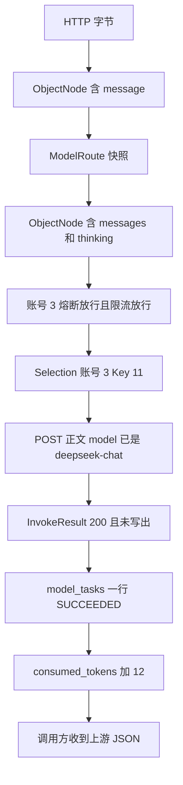

# 第 9 课：一次文本请求的源码追踪

### 1. 本节课我们要学什么？

打开 IDE，从 `ChatCompletionController.chat` 开始，用一份假数据走到返回给业务系统的 JSON。每经过一个类，都知道它为什么在这条链上，输入是什么，输出是什么。

这一课只追非流式文本的主路径，并在末尾加一个「第一次 500、第二次 200」的分支。视频不要套这张表，查询的差异在第 4 课。

### 2. 先讲一个生活中的例子

跟着一张快递面单走完分拣中心。面单每过一个窗口，上面的格子被填上：货齐全吗、线路今天开吗、派哪位快递员、对方回执是什么。你要能在任意一个窗口停下来，说出面单现在长什么样。

下面的「数据长什么样」就是这张面单。

### 3. 为什么需要这个技术？

只记类名，一到线上 400 就不知道停在哪一扇门。把一份具体 JSON 的变化记熟之后，排查就是在问：面单是在改 `message` 之前被退回的，还是在上游回来之后被原样退回的。

### 4. 技术原理

方法调用是同步的。`handle` 调用 `resolve` 时，`handle` 停在那一行，等 `resolve` 返回或抛异常。没有消息队列把这些步骤拆成后台作业。所以你在 IDE 里单步进入，顺序和文档一致。

Spring 已经把对象造好了。你单步时看到的 `routes`、`admission`、`loadBalancer` 是构造方法里那些接口的真实对象：`RouteResolver`、`ModelAdmission`、`RoundRobinAccountLoadBalancer`。

### 5. 放到我们的项目中

假设库里有这样的配置。数字是为了追踪好算，你的库里 id 会不同。

| 表 | 内容 |
| --- | --- |
| `models` | id 7，`model_name` 为 `deepseek-flash`，`adapter_name` 为 `openai`，`upstream_model_name` 为 `deepseek-chat`，`base_url` 为 `https://api.deepseek.com/chat/completions`，`enabled` 为 1，负载均衡开，限流开，RPM 60。`tpm` 列为空，准入不读取 |
| `model_accounts` | 模型 7 连着账号 3 和账号 5，链接都启用 |
| `provider_accounts` | 3 和 5 都启用，且都属于这个模型的供应商 |
| `account_keys` | 账号 3 有 Key id 11；账号 5 有 Key id 12。都启用 |

Redis 账号游标当前 INCR 之前的值无关紧要。假设这次 `INCR` 返回 1，于是账号下标 `(1-1) % 2 = 0`，选中账号 3。Key 游标 INCR 返回 1，账号 3 只有一把 Key，下标 0，选中 Key 11。

账号 3 和账号 5 的熔断状态都是 `closed`，键分别是 `llm-gateway:cb:7:3` 和 `llm-gateway:cb:7:5`。这个模型最近 60 秒里还没有限流记录，限流键仍是 `llm-gateway:rl:7`，不带账号。

### 6. 核心代码逐段讲解

请按这个顺序在 IDE 里点「转到定义」。每一步都写了你应该看见的数据。

#### 第 0 步：请求从哪进来

文件 `web/ChatCompletionController.java`，方法 `chat`。

输入是 HTTP。我们假定：

```http
POST /v1/chat/completions
Content-Type: application/json
X-Gateway-Timeout-Ms: 30000

{"model":"deepseek-flash","message":"只回复一个字：好","max_tokens":16}
```

控制器不解析这些字节。它把 `request` 和 `response` 交给 `ChatCompletionService.handle`。

#### 第 1 步：读成对象

`JsonBodies.object`。输入是输入流里的原始字节。输出是 `ObjectNode`。

此时 `body` 用文字写出来是：

```json
{"model":"deepseek-flash","message":"只回复一个字：好","max_tokens":16}
```

如果字节是空的、不是 JSON、或是数组，这里抛 `GatewayException`，后面全部不执行。`GatewayExceptionHandler.handleGateway` 写出 400。

#### 第 2 步：取出模型名和超时

`JsonBodies.requiredText(body, "model")` 得到字符串 `deepseek-flash`。

`HeaderTimeoutPolicy.resolve` 读到头 `30000`，输出 `Duration.ofMillis(30000)`。变量名 `timeout`。重试时还用它。

#### 第 3 步：变成路由快照

`RouteResolver.resolve("deepseek-flash")`。

内部 `DbModelCatalog.findModel` 打到 `ModelCatalogMapper.selectByName`。`ModelRow.enabled` 是 1。`AdapterRegistry.find("openai")` 非空。`selectCandidates` 得到扁平行，`AccountPool.group` 收成两个 `AccountCandidate`：账号 3 带着 Key 11，账号 5 带着 Key 12。

输出 `ModelRoute`：

| 字段 | 值 |
| --- | --- |
| `modelId` | 7 |
| `modelName` | deepseek-flash |
| `adapterName` | openai |
| `baseUrl` | https://api.deepseek.com/chat/completions |
| `upstreamModelName` | deepseek-chat |
| `accounts` | 账号 3、账号 5 |
| `loadBalanceEnabled` | true |
| `rateLimitEnabled` | true |
| `rpm` | 60 |
| `tpm` | null |

`positive` 把空的 RPM 或 TPM 收成 null。这里 RPM 是 60。TPM 留在快照上，后面的限流不用它。

#### 第 4 步：确认这是对话适配器

`adapters.required("openai")` 得到 `OpenAiChatAdapter`。`supports(CHAT_COMPLETION)` 为 true。变量 `adapter` 的编译类型是接口，运行类型是这个类。

#### 第 5 步：改正文

`rewritePlainMessage` 之后，`message` 字段消失，多了 `messages`。

`disableThinkingByDefault` 看到没有 `thinking`，补上关闭。

现在内存里的 `body` 是：

```json
{
  "model": "deepseek-flash",
  "max_tokens": 16,
  "messages": [{"role": "user", "content": "只回复一个字：好"}],
  "thinking": {"type": "disabled"}
}
```

`model` 仍是调用名。换成 `deepseek-chat` 是适配器里的事，还没发生。

`body.path("stream").asBoolean(false)` 得到 false。

#### 第 6 步：估算 Token 并选账号

`mapper.writeValueAsBytes(body)` 是上面这份 JSON 的 UTF-8 字节。`RateWindows.estimate` 用长度除以 4，至少 1。假定算出来是 40。变量 `estimate`。真实长度和空格有关，单步时以调试器里的整数为准。

`RoundRobinAccountLoadBalancer.select`。

`RedisRotationCursor.increment("llm-gateway:rr:model:7:account")` 返回 1。下标 0。账号 3。

`RedisModelCircuitBreaker.acquire(7, 3)` 执行 `circuit.lua` 的 `acquire`。状态关闭，返回 1。`Permit.closed()`，`allowed` true，`probing` false。这就是 `Selection.circuitPermit`。

`pickKey` 再 INCR `llm-gateway:rr:model:7:account:3`，返回 1。Key 11。

输出 `Selection`：route 是第 3 步那份，accountId 3，keyId 11，`accountIndex` 0，外加上面的熔断 `Permit`。`toString` 不会带出 Key 字符串，但对象里的 `ApiCredential` 有，适配器马上要用。

如果账号 3 的 `acquire` 返回 0，选择不会 `pickKey`，而是从下标 1 的账号 5 再 `acquire(7, 5)`。两个都拒绝才抛 503，「模型暂时不可用」，并且不会进入下一步的限流。

账号游标 INCR 若抛 Redis 异常，发生在 `acquire` 之前，没有熔断名额要还，直接 503「轮询计数不可用」。Key 游标 INCR 若在 `acquire` 之后失败，`admit` 调用 `breaker.release(7, 3, permit)`。关闭状态下的 `release` 看到不是试探，直接 return，不打 Lua 的 release。熔断失败次数不变。

#### 第 7 步：模型级限流

`ModelAdmission.enter` 拿到第 6 步的账号 id 和熔断 `Permit`。

`RedisModelRateLimiter.inspect` 执行 `rate-limit.lua`。Java 会先生成一个 `reservationId`。RPM 上限 60。脚本不接收 Token。它先删掉年龄大于等于 60 秒的成员。这次窗口是空的，于是写入成员 `reservationId`，分数是当前毫秒。返回 1。放行。返回的 `Permit` 仍是账号 3 的熔断许可，只是带上了这个 `reservationId`。第 6 步算出的 40 不写入这把键。

如果这里抛 429，会归还账号 3 的半开名额，不记熔断失败，不会有第 8 步。账号游标和 Key 游标在第 6 步已经加过。

#### 第 8 步：组装命令并发 HTTP

`command(...)` 得到 `InvokeCommand`：

| 字段 | 值 |
| --- | --- |
| `operation` | `CHAT_COMPLETION` |
| `selection` | 第 7 步 |
| `body` | 第 5 步的对象，还没换模型名 |
| `timeout` | 30 秒 |
| `stream` | false |
| `taskId` | null |

`OpenAiChatAdapter.invoke` 里 `JsonBodies.replaceModel` 把 `body` 的 `model` 改成 `deepseek-chat`，并序列化成字节。这份字节才是 POST 的正文。内存里的 `ObjectNode` 也被改了，所以现在 `model` 字段是 `deepseek-chat`。

请求头只有两个：`Authorization: Bearer` 加上 Key 11 的明文，以及 `Content-Type: application/json`。

`UpstreamClient.send` POST 到 `https://api.deepseek.com/chat/completions`，`HttpRequest.timeout` 30 秒，`stream` 参数 false，所以用字节数组把响应读完。

假定上游返回 200，正文是：

```json
{
  "choices": [
    {"message": {"role": "assistant", "content": "好"}}
  ],
  "usage": {"total_tokens": 12}
}
```

适配器把它包成 `InvokeResult`：status 200，contentType `application/json`，body 是这段字节，`retryable` false，`committed` false。

`retryable` 为 false，不会进 `nextAccount`。

#### 第 9 步：记账

`call` 在 `invoke` 成功返回后立刻 `CallRecords.record`。

正文里没有 `output.task_id`，所以 `taskId` 是新的 UUID，例如 `8f2c0a1e-...`。没有 `output.task_status`，HTTP 是 200，状态写成 `SUCCEEDED`。

`DbTaskBindingStore.record` 执行插入：

| 列 | 值 |
| --- | --- |
| `task_id` | 那个 UUID |
| `model_name` | deepseek-flash |
| `provider_account_id` | 3 |
| `task_status` | SUCCEEDED |

调用方的模型名用的是 `selection.route().modelName()`，不是上游名 `deepseek-chat`。

#### 第 10 步：回写熔断和 Token

`ModelAdmission.finish`。`CallOutcome.of` 看到 200，得到 `SUCCESS`。

`breaker.succeed(7, 3, permit)` 把账号 3 的熔断哈希重置为关闭、失败 0。账号 5 的键不动。

`adapter.reportedTotalTokens` 读到 12。`finish` 不再回写限流窗口。

`usage.add(7, 12)` 执行 `TokenUsageMapper` 的 SQL：`consumed_tokens = consumed_tokens + 12`。这个 12 不改变 RPM。

如果 `reportedTotalTokens` 是空，成功分支仍会 `recordUsage(route, estimate)`，也就是加那个 40。这次不是空，所以加的是 12，不是 40。

#### 第 11 步：写给调用方

`result.committed()` 为 false，`ResponseWriter.writeBuffered` 把状态 200 和上游字节写进 `response`。业务系统看到的就是第 8 步那个 JSON，外面没有再包 `error`。

然后 `log.info` 一行：operation=chat，model=deepseek-flash，accountId=3，keyId=11，status=200，elapsedMs 为从 `select` 之前的 `started` 算起的毫秒。这一行在写响应之后。如果写响应抛了 IO 异常，你可能看到上游已经成功，但这行日志没有。

#### 分支：第一次 500，账号 5 返回 200

在第 8 步，若状态是 500，`retryableStatus` 为 true，`committed` 为 false。

换账号之前，`admission.observe` 按 500 给账号 3 调用 `breaker.fail(7, 3, permit)`。账号 3 的失败次数加一。账号 5 还没动。

`nextAccount` 看到账号数是 2，从下标 1 开始找还没熔断的账号，得到账号 5，并对它 `acquire(7, 5)`。它不再 INCR 账号游标。它会为账号 5 `pickKey`，那把 Key 的游标会加一。如果账号 5 已经打开，`nextAccount` 返回空，后面的第二次调用不会发生。

第二次 `call` 再次 `invoke`。`model` 已经是 `deepseek-chat`，`replaceModel` 再写一次同样的值。假定这次 200。

记账会发生两次。第一次 `record` 在第一次 `call` 里已经执行，状态按 500 记成 `FAILED`，UUID 是另一条。第二次是新的 UUID，`SUCCEEDED`。表里两行，账号分别是 3 和 5。

`finish` 只处理账号 5 的 200，`breaker.succeed(7, 5, permit)`。账号 3 刚才那一次失败还在。

`writeBuffered` 只写第二次的正文。调用方看不到第一次的 500 正文。

如果账号 5 不存在，或者它的熔断已经打开，`nextAccount` 返回空。这时不会再 `observe` 一次。`finish` 看到的就是账号 3 的 500，再给账号 3 `fail` 一次。调用方拿到上游的 500 正文。所以「换账号成功」和「没换成就结束」对账号 3 的计数不一样：换成了，失败只在 `observe` 里记一次；没换成，失败在 `finish` 里记一次。不会两处都记。

### 7. 配图理解

把上面的变量收成一张你可以贴在显示器旁边的图：



对照源码时，不要找一个叫 `Pipeline` 的类。箭头就是 `handle` 方法从上到下的局部变量。跳出去又跳回来的大段是 `loadBalancer.select`、`admission.enter` 和 `adapter.invoke`。`select` 在 `enter` 前面。

### 8. 常见误区

- 「写给调用方发生在记账之前。」非流式相反。`call` 里先记账，`handle` 末尾才 `writeBuffered`。所以会出现「表里已经 SUCCEEDED，但写 socket 时调用方断开」这种时间差。
- 「快照里的 `model` 字符串会自己变成上游名。」不会。`ModelRoute.upstreamModelName` 是另一个字段。JSON 里的 `model` 直到 `replaceModel` 才改。
- 「这次请求的 rpm 在成功后会减掉。」不会。RPM 是窗口里的一条记录，进门时写下，成功后不会删掉，真实 Token 也不会改它。

### 9. 本节课总结

这份请求的面单变化是：原始 JSON，到带 `messages` 的对象，到路由快照，到放行许可，到账号 3 和 Key 11，到模型名被换成 `deepseek-chat` 的上游请求，到留在内存里的 200 响应，到 `model_tasks` 和 `consumed_tokens`，最后才写回调用方。你应该能在 IDE 里把每一步停住。

### 10. 课后练习

入门：在第 5 步结束时，JSON 里还有 `message` 吗？`model` 是什么？

参考答案：没有 `message`。`model` 仍是 `deepseek-flash`。上游名要到 `OpenAiChatAdapter.invoke` 里的 `replaceModel` 才写上。

进阶：如果 `supports` 返回 false，第 5 步的改正文发生了吗？

参考答案：没有。`handle` 里 `supports` 的判断在 `rewritePlainMessage` 之前。视频模型会得到「该模型不能用于对话接口」，而不是「message 必须是非空字符串」。

实战：按第 7 步的 Redis 键，写出这次会 INCR 的两个键名。如果第一次 500 后换到账号 5，第三个被 INCR 的键是什么？账号游标键会不会再加？

参考答案：`llm-gateway:rr:model:7:account` 和 `llm-gateway:rr:model:7:account:3`。换到账号 5 时还会 INCR `llm-gateway:rr:model:7:account:5`。账号游标键不会第二次 INCR，因为走的是 `nextAccount`。

---

# 附：调试时怎么停

IDE 里给这些行下断点就够覆盖主路径。

| 你想确认的事 | 断点位置 |
| --- | --- |
| 正文改写完没有 | `ChatCompletionService.handle` 里 `estimate` 那一行 |
| 为什么 404 | `RouteResolver.resolve` 里判断 `enabled` 的那一行 |
| 有没有打到上游 | `UpstreamClient.send` 的第一行 |
| 为什么没有重试 | `handle` 里 `result.retryable()` 那一行 |
| 错误 JSON 谁写的 | `GatewayExceptionHandler.handleGateway` |

断点命中后先看变量，再单步进入。不要一进 `send` 就去读 JDK 的 `HttpClient` 源码，那是库的内部，确认 URL、头和超时之后就跳出来。
