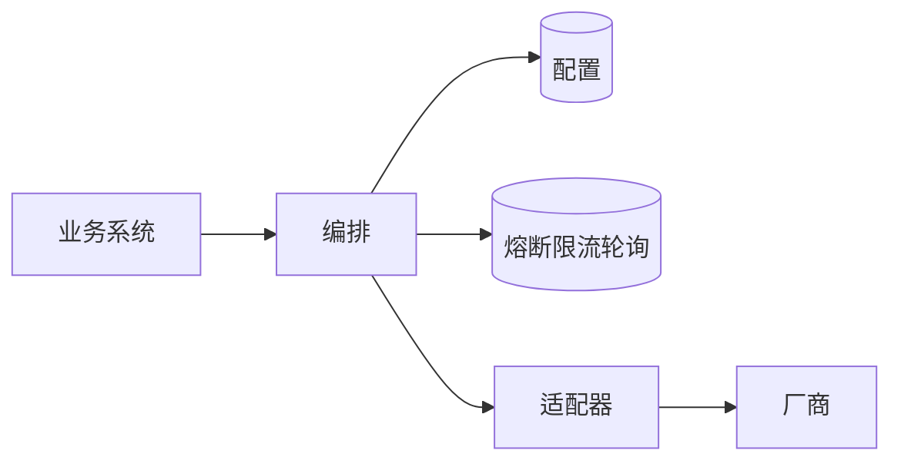

# 第 11 课：面试里怎么讲这个项目

### 1. 本节课我们要学什么？

用三分钟把项目讲完，并准备好追问。讲的每一句都要能落到类名。不会的就说当前没做，不要把令牌桶、漏桶、图像生成、取消上游任务讲成已实现。滑动窗口是已经做了的。

### 2. 先讲一个生活中的例子

面试官像一个只给你三分钟的值班经理。他想知道你负责的窗口每天处理什么单、什么单你会拒、出了事故你查哪本台账。他不想听你把保险丝的物理学从 1820 年讲起。先讲值守范围，再讲最容易出事的两个开关：限流和熔断。他追问时，你再打开其中一层。

### 3. 为什么需要这个技术？

项目讲不清楚，通常是因为按包名背了一遍。听众不知道业务问题。另一类失败是把网上的网关架构图背下来，和仓库对不上，一追问 `AdapterFactory` 就露馅。

下面的稿子只包含这个仓库里的事实。

### 4. 技术原理

三分钟稿子按四段说，不要按包的字母顺序说。

第一段，问题。业务要同时用对话模型和视频模型。各家 URL、鉴权、同步还是异步都不一样。Key 不能散落在每个业务服务里。一家模型连续失败时，不能把所有请求都堵在超时上。

第二段，做法。调用方只访问网关的三个地址，不带上游 Key。网关用模型名到 MySQL 查地址、适配器和可用账号。选账号时按「模型 + 账号」看 Redis 熔断，打开的账号跳过。选定后再做这个模型滚动 60 秒的限流。文本走 OpenAI 兼容适配器，视频走万相适配器。适配器只改协议，换不换账号由编排层决定。

第三段，一个请求。读 JSON，确认模型启用且协议匹配，把 `message` 收成一条 user 消息，选一个还没熔断的账号，再查模型级限流，POST 到模型行上的完整 URL。401、429、5xx 且还没把字节写给调用方时，先记下这个账号自己的结果，再换下一个还没熔断的账号试一次。超时和连接失败不换。成功的非流式响应原样返回。每次调用写入 `model_tasks`。

第四段，你负责时会怎么扩展。又一家 Chat Completions 只加配置。一家新协议才加一个 `ProtocolAdapter` Bean。编排、限流、熔断不用复制。

然后停下来。让面试官选一条追问。

### 5. 放到我们的项目中

背这张「追问对照」，答的时候点到类，即可停下，不要把整段源码背出来。

| 面试官可能问 | 你第一句回答 | 落到哪 |
| --- | --- | --- |
| 为什么不直接调厂商？ | Key、协议、失败转移和停用都收口在网关 | `account_keys`、`ProtocolAdapter` |
| 兼容协议解决了什么？ | 千问和 DeepSeek 共用一个适配器，差别在 `base_url` | `OpenAiChatAdapter` |
| 视频为什么另一个类？ | 异步头、任务查询 URL、必须回到创建账号 | `DashScopeWanAdapter`、`TaskUris`、`selectKey` |
| 控制器为什么返回 void？ | 流式要直接写响应，不能等对象序列化 | `ChatCompletionController` |
| 怎么选账号？ | Redis INCR 取余，再跳过这个模型上已熔断的账号；关闭负载均衡就用最小 id，它熔断了就 503 | `RoundRobinAccountLoadBalancer` |
| 重试会不会打乱轮询？ | `nextAccount` 不再 INCR 账号键，并跳过已打开的账号 | 同文件 |
| 限流算法？ | 滑动窗口，最近 60 秒，按模型，不是令牌桶，也不是整点清零 | `rate-limit.lua` |
| 为什么 Lua？ | 让 RPM 的判断与增加原子化。不按 Token 限流 | `RedisModelRateLimiter` |
| 熔断和限流区别？ | 熔断按模型加账号，看连续失败；限流按模型，看最近 60 秒的量 | `circuit.lua`、`ModelAdmission.enter` |
| 半开谁来触发？ | 下一个请求，没有后台线程 | `circuit.lua` 的 acquire |
| 超时等于取消吗？ | 不等于。网关不再读，没有发取消 | `UpstreamClient` |
| 超时重试吗？ | 不重试。只对 401、429、5xx 换一次账号 | `JsonBodies.retryableStatus` |
| 流式做了吗？ | 文本做了，按块转发，不解析 SSE | `ResponseWriter.copyStream` |
| 流式为什么不能重试？ | 第一块已经写出，`committed` 为 true | `InvokeResult.streamed` |
| 是工厂还是策略？ | 策略是适配器实现。没有请求级工厂。Spring 创建，注册表按名字取 | `AdapterRegistry` |
| 配置存在哪？ | MySQL 五张配置表加任务表。Redis 只有游标、限流桶、熔断 | `RedisKeys` |
| 怎么停用一个模型？ | `enabled` 置 0，下一次 resolve 404，不打上游 | `RouteResolver` |
| 事务？ | 模型调用没有包事务。管理端保存配置有 `@Transactional` | `AdminService` |
| 图像呢？ | 没做 | `AdapterOperation` 只有三项 |

### 6. 核心代码逐段讲解

面试里最多展开一段代码。建议就展开准入，因为它最能证明你知道顺序。

```java
Permit permit = breaker.acquire(route.modelId(), account.accountId());
if (!permit.allowed()) {
    return Optional.empty();
}
```

你配合说：这是选账号时的判断，键是 `llm-gateway:cb:{modelId}:{accountId}`。一个账号返回拒绝就换下一个，不是整个模型 503。全部候选都拒绝才 503，并且不会把 RPM 加一。限流在账号选定之后。限流若拒绝，会把这个账号的半开名额还回去，并且不调用 `fail`。这三句比背状态机图更像你读过代码。

第二段如果对方追问重试，就说 `retryable && !committed`，并补上「账号游标不加」。

不要主动讲 `InfrastructureConfig` 里的默认主机地址。那是环境兜底，不是架构亮点。被问到配置从哪来，说环境变量和 `application-local.yml`，密码不进 Git。

### 7. 配图理解

讲的时候可以在纸上画这六个盒子，不必画到类。



口述顺序：业务只进编排；编排先读配置再问 Redis；通过之后适配器才接触厂商。画完补一句：任务流水在 MySQL 的 `model_tasks`，不在 Redis。

### 8. 常见误区

面试时这些句子不要说。

- 「我们用令牌桶限流。」实际是滚动 60 秒的滑动窗口。每次放行一条记录，满 60 秒才离开。没有按秒补充令牌。
- 「用了 Resilience4j。」没有。是 Redis Lua。优点是状态跨实例，而且一个账号打开不会拖死同模型的其他账号。缺点是阈值是全局配置，不是每个账号一行阈值。限流仍然是整个模型一份 RPM。网关不执行 TPM，供应商的 TPM 错误按上游正文返回。
- 「工厂模式创建适配器。」说成 Spring 单例加注册表。
- 「超时会换一个账号再请求。」不会。
- 「流式我们解析了增量并统一成自己的事件。」没有，是字节转发。
- 「有完善的监控大盘。」没有指标系统。有结构化的一行完成日志，以及失败时的 warn 和 error。排查主要靠状态码、这行日志和 `model_tasks`。
- 「所有错误都统一成网关 JSON。」只有网关自己抛的 `GatewayException` 才是。上游正文原样返回。

被问到缺点时，可以主动讲一个真的，这比说「没有缺点」可信。

可选的一个缺点：非流式重试的两次 `HttpRequest.timeout` 各自使用同一段时长，最坏等待可以接近两倍预算；流式的 `deadline` 才是从开始时刻算的绝对截止。另一个缺点：任务表写入失败会走到 `admission.fail`，基础设施故障可能被记成这个账号的熔断失败。第三个：没有调用方维度的限流，`X-Gateway-Client-Id` 只是预留。挑你真的看懂的那一个讲，并说出如果要改会动哪个类。

### 9. 本节课总结

三分钟讲完问题、做法、一次请求、如何扩展。追问时用类名停在一层，不要把没做的算法讲成实现。限流是模型级滑动窗口，熔断是账号级的连续失败加半开试探，超时不重试，流式是转发，适配器是策略加注册表。

### 10. 课后练习

入门：用不超过 150 字讲完这个项目。计时说一遍。

参考答案示例：这是一个 Java 大模型网关。业务系统只调它，不持有厂商 Key。模型地址和账号在 MySQL。选账号时按模型加账号做熔断，打开的账号跳过，然后再做这个模型滚动 60 秒的限流。适配器按 OpenAI 或万相协议去调用。上游 401、429 和 5xx 可以换一个还没熔断的账号再试一次，超时不试。文本支持 SSE 转发。每次调用记在 `model_tasks`。

进阶：面试官说「固定窗口和你们的滑动窗口有什么差别」。你怎么回答？

参考答案：固定窗口按整分钟换一把新计数，上一分钟最后一秒和下一分钟第一秒可以各放满一次。本项目的键是 `llm-gateway:rl:{modelId}`，成员带毫秒时间戳。`rate-limit.lua` 先删掉年龄大于等于 60 秒的成员，再决定这次写不写。所以整点不会把额度清零。不要把它说成令牌桶。

实战：面试官让你白板写出「新增一家非兼容协议」的步骤。按顺序列出，并标明哪一步必须重启。

参考答案：写 `ProtocolAdapter` 实现并加 `@Component`；`name()` 唯一；`invoke` 使用 `UpstreamClient`，把是否可重试交给现有状态判断；重启进程让 `AdapterRegistry` 收进 Map；在表里把 `adapter_name` 写成同一个字符串并配账号；从对应的 `/v1` 入口调用。必须重启的是「新的 Java 类进入 Map」这一步。仅仅再加一个 OpenAI 兼容 URL 不用重启，也不用新类。

---

## 讲完之后的自检

把第 0 课那张步骤表盖住，在纸上重画一次。画完打开 `ChatCompletionService.handle`，逐行对。对得上，这套课的目标就达到了：你能不看文档讲清业务，也能在 IDE 里指出每一句对应的代码。

对不上的那一行，只回到涉及它的那一课，不要从头再读。例如对不上重试，就回到第 6 课和第 8.6 节；对不上半开，就回到第 7 课的数字例子和第 8.5 节的 Lua。
